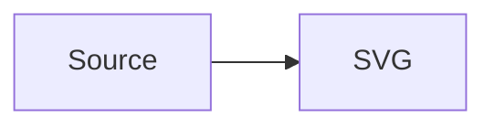

# Mermaid Pele Preview

A VS Code extension that renders Mermaid diagrams with [Pele](https://github.com/obsidianmd/pele).

- `.mmd` and `.mermaid` files open in a Mermaid preview by default.
- ` ```mermaid ` code blocks are rendered in the built-in Markdown preview.
- Diagrams adapt to the editor width, support zoom and pan, and follow the current VS Code theme.
- Rendering happens in the webview with Pele's synchronous, dependency-free renderer. No Mermaid.js runtime is used.

## Usage

Open a `.mmd` or `.mermaid` file. The custom editor shows the rendered diagram and updates as the text changes.

To edit the source, use the **Open Mermaid Source** button in the editor title bar, or run **Mermaid: Open Mermaid Source** from the Command Palette.

To return to the preview from a source editor, use the **Open Mermaid Preview** button or run **Mermaid: Open Mermaid Preview**.

In Markdown, open the built-in preview (`Ctrl+Shift+V` / `Cmd+Shift+V`). Every fenced block tagged `mermaid` is rendered with Pele:

````markdown

````

## Syntax highlighting

`.mmd` and `.mermaid` files, and fenced ` ```mermaid ` blocks in Markdown, are highlighted with a TextMate grammar vendored from [bpruitt-goddard/vscode-mermaid-syntax-highlight](https://github.com/bpruitt-goddard/vscode-mermaid-syntax-highlight) (MIT, copyright Brian Pruitt-Goddard).

The Markdown grammar is injected into `text.html.markdown`, so it works in plain Markdown files and in Markdown editors that support TextMate injection.

## Icons

Diagrams can use Font Awesome icon syntax such as `fa:fa-code`, `fa:fa-arrow-left`, or `fab:fa-youtube`. A small built-in subset is bundled; unsupported icon names are omitted.

## Zoom and pan

Each diagram has a zoom toolbar above it with a zoom percentage, zoom out, zoom in, and **Fit** buttons.

Zooming grows the diagram canvas vertically so the whole diagram stays visible while the page scrolls. The width remains limited to the editor width; drag horizontally to pan.

- Use the toolbar, `Ctrl`/`Cmd` + wheel (including trackpad pinch), or double-click to zoom.
- Drag with the mouse or a finger to pan horizontally when zoomed.
- Focus the diagram and press the arrow keys to pan, `+`/`-` to zoom, or `0` to fit.

## Settings

| Setting | Values | Description |
| --- | --- | --- |
| `mermaidView.theme` | `auto` (default), `light`, `dark` | Color theme for diagrams. `auto` follows the VS Code theme; `light` and `dark` force Pele's palette. |
| `mermaidView.fontFamily` | CSS `font-family` string; empty by default | Font family for diagram text. Leave empty to use the VS Code font. For example: `"Fira Code", monospace`. |

The custom editor applies theme and font changes immediately. Reopen the Markdown preview to apply changed settings to its diagrams.

## Commands

| Command | Description |
| --- | --- |
| `Mermaid: Open Mermaid Source` | Open the active Mermaid preview as text |
| `Mermaid: Open Mermaid Preview` | Open the active `.mmd` / `.mermaid` file in the preview |
| `Mermaid: Open Mermaid Preview to the Side` | Open the active `.mmd` / `.mermaid` file in a preview beside the editor (`Ctrl+K V` / `Cmd+K V`) |

The side-preview command is also available from the Explorer context menu for `.mmd` and `.mermaid` files.

## Development

This project uses [pnpm](https://pnpm.io) and keeps dependency versions in the catalog in `pnpm-workspace.yaml`.

```sh
pnpm install
pnpm run typecheck
pnpm run lint
pnpm run compile
```

Press `F5` to launch an Extension Development Host, or package the extension:

```sh
pnpm run package
```

The extension host is bundled to `dist/extension.js`. The webview renderer, including Pele, is bundled to `media/webview.js`; `media/preview.css` maps Pele's CSS variables to VS Code theme colors.

## License

MIT
