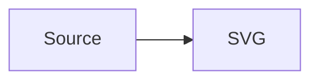
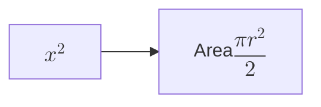

# Mermaid Pele Preview

A VS Code extension that renders Mermaid diagrams with [Pele](https://github.com/obsidianmd/pele).

- `.mmd` and `.mermaid` files open in a Mermaid preview by default.
- ` ```mermaid ` code blocks are rendered in the built-in Markdown preview.
- Diagrams adapt to the editor width: wide diagrams open fitted to the available width, narrow diagrams keep their natural size, and the fit adjusts when the preview is resized until you zoom manually.
- Hover or focus a diagram to reveal zoom, per-diagram light/dark, and **Save SVG** controls. They are hidden when not hovered and omitted from print.
- Rendering happens in the webview with Pele's synchronous renderer. Math labels are typeset locally with Temml. No Mermaid.js runtime is used.

## Usage

Open a `.mmd` or `.mermaid` file. The custom editor shows the rendered diagram and updates as the text changes.

To edit the source, use the **Open Mermaid Source** button in the editor title bar, or run **Mermaid: Open Mermaid Source** from the Command Palette.

To return to the preview from a source editor, use the **Open Mermaid Preview** button or run **Mermaid: Open Mermaid Preview**.

In Markdown, open the built-in preview (`Ctrl+Shift+V` / `Cmd+Shift+V`). Every fenced block tagged `mermaid` is rendered with Pele:

````markdown

````

## Math

Use `$$...$$` in diagram labels to typeset math:

````markdown

````

Math is rendered locally with [Temml](https://temml.org/) and works in the same diagram types as Mermaid 12.1: flowchart, sequence, state, class, ER, mindmap, kanban, block, requirement, and use case diagrams. Class members and diagram titles stay as plain text. Malformed expressions fall back to the TeX source.

Math is inserted as MathML inside the SVG, so exported SVGs show it in browsers. Some standalone SVG viewers do not render `foreignObject` content.

## Syntax highlighting

`.mmd` and `.mermaid` files, and fenced ` ```mermaid ` blocks in Markdown, are highlighted with a TextMate grammar vendored from [bpruitt-goddard/vscode-mermaid-syntax-highlight](https://github.com/bpruitt-goddard/vscode-mermaid-syntax-highlight) (MIT, copyright Brian Pruitt-Goddard).

The Markdown grammar is injected into `text.html.markdown`, so it works in plain Markdown files and in Markdown editors that support TextMate injection.

## Icons

Diagrams can use Font Awesome icon syntax such as `fa:fa-code`, `fa:fa-arrow-left`, or `fab:fa-youtube`. The resolver imports its icons from the official Font Awesome Free packages; a small subset is bundled, and unsupported icon names are omitted.

## Diagram controls

Hover or focus a diagram to reveal its toolbar in the top-right corner. The toolbar is hidden when not hovered and omitted from print, so static captures and PDFs do not show the controls.

- **Save SVG** saves the diagram at its natural size as a standalone SVG, including the active palette and background. The current fit/zoom does not change the exported size. Math is preserved as MathML; browsers render it, but some standalone SVG viewers do not. The custom editor opens a save dialog; the Markdown preview and exported HTML download the file.
- **☀ / ☾** force the light or dark palette for that diagram. The toolbar and its buttons switch palette with the diagram. Click the active button again to return to the automatic theme. Colors set explicitly in the Mermaid source (`theme`, `themeVariables`, `style`, `classDef`) are not changed.
- The zoom percentage, **−**, **+**, and **Fit** buttons control zoom. Each **+**/**−** step moves between whole 100% levels (100%, 200%, 300%, 400%); from a fitted size below 100%, the first **+** goes to 100%. `Ctrl`/`Cmd` + wheel gives finer steps. **Fit** returns to the width-fitted size; the percentage is relative to the diagram's natural size, so a wide diagram can show less than 100% at fit.

Wide diagrams are scaled down to the available width by default and refit when the preview is resized until you zoom manually; narrow diagrams keep their natural size. Zooming grows the diagram canvas vertically so the whole diagram stays visible while the page scrolls. The diagram is clipped to its container horizontally, so the page itself does not scroll sideways; drag horizontally to pan when zoomed.

- Use the toolbar, `Ctrl`/`Cmd` + wheel (including trackpad pinch), or double-click to zoom.
- Drag with the mouse or a finger to pan horizontally when zoomed.
- Focus the diagram and press the arrow keys to pan, `+`/`-` to zoom, or `0` to fit.

## Settings

| Setting | Values | Description |
| --- | --- | --- |
| `mermaidView.theme` | `auto` (default), `light`, `dark` | Color theme for diagrams. `auto` follows the VS Code theme; `light` and `dark` force Pele's palette. |
| `mermaidView.fontFamily` | CSS `font-family` string; empty by default | Font family for diagram text. Leave empty to use the VS Code font. For example: `"Fira Code", monospace`. |

The custom editor applies theme and font changes immediately. Reopen the Markdown preview to apply changed settings to its diagrams. The per-diagram light/dark buttons override this setting for individual diagrams.

## Commands

| Command | Description |
| --- | --- |
| `Mermaid: Open Mermaid Source` | Open the active Mermaid preview as text |
| `Mermaid: Open Mermaid Preview` | Open the active `.mmd` / `.mermaid` file in the preview |
| `Mermaid: Open Mermaid Preview to the Side` | Open the active `.mmd` / `.mermaid` file in a preview beside the editor (`Ctrl+K V` / `Cmd+K V`) |

The side-preview command is also available from the Explorer context menu for `.mmd` and `.mermaid` files.

## Development

This project uses [pnpm](https://pnpm.io) and keeps dependency versions in the catalog in `pnpm-workspace.yaml`.

```sh
pnpm install
pnpm run typecheck
pnpm run lint
pnpm run compile
```

Press `F5` to launch an Extension Development Host, or package the extension. On Linux and macOS, the F5 prelaunch task uses `scripts/compile-task.sh`, which locates an nvm-managed Node/pnpm installation when VS Code was started with a minimal GUI PATH.

```sh
pnpm run package
```

The extension host is bundled to `dist/extension.js`. The webview renderer, including Pele and Temml, is bundled to `media/webview.js`; `media/preview.css` maps Pele's CSS variables to VS Code theme colors, and `media/temml.css` carries the math styles and font.

## Changelog

See [CHANGELOG.md](CHANGELOG.md) for release notes.

## License

MIT
