# Pele website examples

Examples shown at [pele.run/examples](https://pele.run/examples).

## Block

### Narrow screens

#### Explicit columns

Labels and spacing tighten while columns and spans keep their positions.

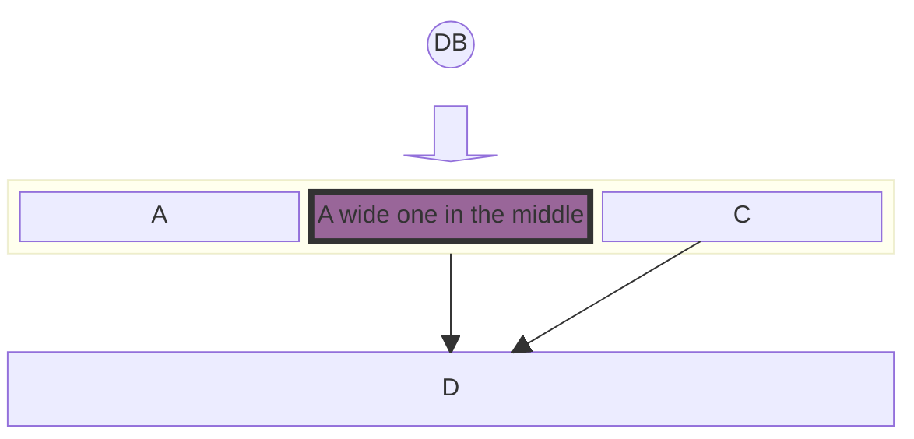

### Documentation examples


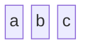

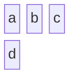

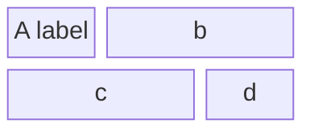

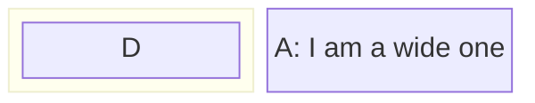

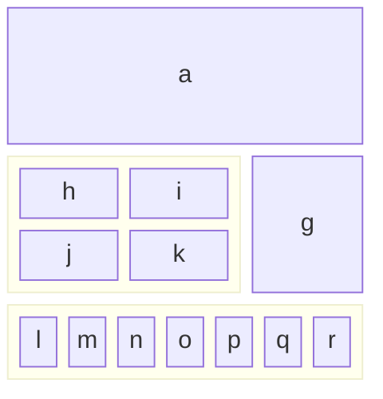

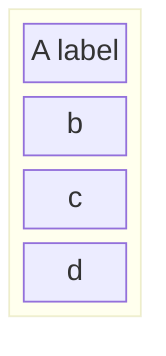

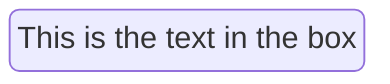

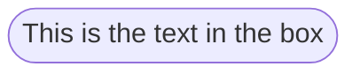

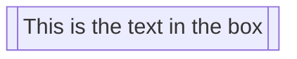

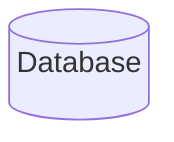

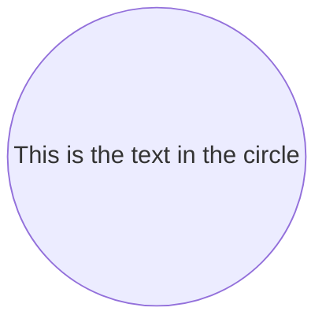

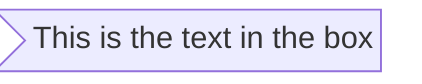

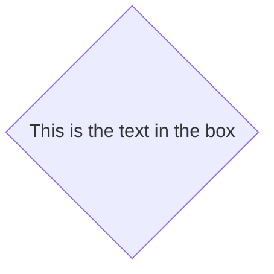

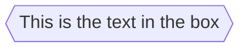

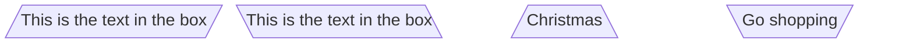

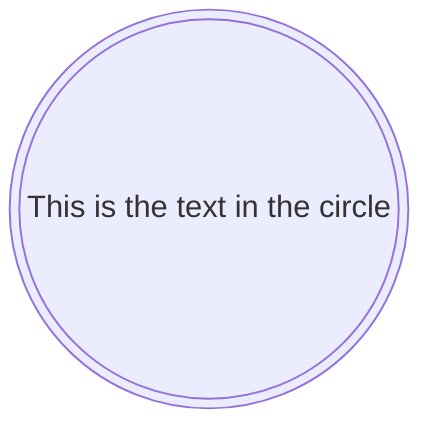

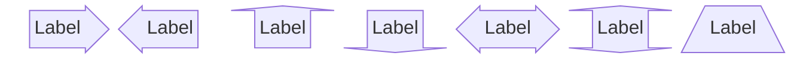

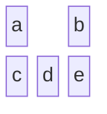

```mermaid
block
  ida space:3 idb idc
```

```mermaid
block
  A space B
  A-->B
```

```mermaid
block
  A space:2 B
  A-- "X" -->B
```

```mermaid
block
columns 1
  db(("DB"))
  blockArrowId6<["&nbsp;&nbsp;&nbsp;"]>(down)
  block:ID
    A
    B["A wide one in the middle"]
    C
  end
  space
  D
  ID --> D
  C --> D
  style B fill:#939,stroke:#333,stroke-width:4px
```

```mermaid
block
  id1 space id2
  id1("Start")-->id2("Stop")
  style id1 fill:#636,stroke:#333,stroke-width:4px
  style id2 fill:#bbf,stroke:#f66,stroke-width:2px,color:#fff,stroke-dasharray: 5 5
```

```mermaid
block
  A space B
  A-->B
  classDef blue fill:#6e6ce6,stroke:#333,stroke-width:4px;
  class A blue
  style B fill:#bbf,stroke:#f66,stroke-width:2px,color:#fff,stroke-dasharray: 5 5
```

```mermaid
block
  columns 3
  Frontend blockArrowId6<[" "]>(right) Backend
  space:2 down<[" "]>(down)
  Disk left<[" "]>(left) Database[("Database")]

  classDef front fill:#696,stroke:#333;
  classDef back fill:#969,stroke:#333;
  class Frontend front
  class Backend,Database back
```

```mermaid
block
  columns 3
  Start(("Start")) space:2
  down<[" "]>(down) space:2
  Decision{{"Make Decision"}} right<["Yes"]>(right) Process1["Process A"]
  downAgain<["No"]>(down) space r3<["Done"]>(down)
  Process2["Process B"] r2<["Done"]>(right) End(("End"))

  style Start fill:#969;
  style End fill:#696;
```

```mermaid
block
  A space B
  A --> B
```

```mermaid
  block
    A
    style A fill#969;
```

```mermaid
block
  A
  style A fill:#969,stroke:#333;
```

## C4

### Narrow screens

#### Nested boundaries

Columns fold within their boundaries. Deep nesting and explicit relation offsets can still need more width.

```mermaid
    C4Context
      title System Context diagram for Internet Banking System
      Enterprise_Boundary(b0, "BankBoundary0") {
        Person(customerA, "Banking Customer A", "A customer of the bank, with personal bank accounts.")
        Person(customerB, "Banking Customer B")
        Person_Ext(customerC, "Banking Customer C", "desc")

        Person(customerD, "Banking Customer D", "A customer of the bank, <br/> with personal bank accounts.")

        System(SystemAA, "Internet Banking System", "Allows customers to view information about their bank accounts, and make payments.")

        Enterprise_Boundary(b1, "BankBoundary") {

          SystemDb_Ext(SystemE, "Mainframe Banking System", "Stores all of the core banking information about customers, accounts, transactions, etc.")

          System_Boundary(b2, "BankBoundary2") {
            System(SystemA, "Banking System A")
            System(SystemB, "Banking System B", "A system of the bank, with personal bank accounts. next line.")
          }

          System_Ext(SystemC, "E-mail system", "The internal Microsoft Exchange e-mail system.")
          SystemDb(SystemD, "Banking System D Database", "A system of the bank, with personal bank accounts.")

          Boundary(b3, "BankBoundary3", "boundary") {
            SystemQueue(SystemF, "Banking System F Queue", "A system of the bank.")
            SystemQueue_Ext(SystemG, "Banking System G Queue", "A system of the bank, with personal bank accounts.")
          }
        }
      }

      BiRel(customerA, SystemAA, "Uses")
      BiRel(SystemAA, SystemE, "Uses")
      Rel(SystemAA, SystemC, "Sends e-mails", "SMTP")
      Rel(SystemC, customerA, "Sends e-mails to")

      UpdateElementStyle(customerA, $fontColor="red", $bgColor="grey", $borderColor="red")
      UpdateRelStyle(customerA, SystemAA, $textColor="blue", $lineColor="blue", $offsetX="5")
      UpdateRelStyle(SystemAA, SystemE, $textColor="blue", $lineColor="blue", $offsetY="-10")
      UpdateRelStyle(SystemAA, SystemC, $textColor="blue", $lineColor="blue", $offsetY="-40", $offsetX="-50")
      UpdateRelStyle(SystemC, customerA, $textColor="red", $lineColor="red", $offsetX="-50", $offsetY="20")

      UpdateLayoutConfig($c4ShapeInRow="3", $c4BoundaryInRow="1")
```

### Documentation examples

```mermaid
    C4Context
      title System Context diagram for Internet Banking System
      Enterprise_Boundary(b0, "BankBoundary0") {
        Person(customerA, "Banking Customer A", "A customer of the bank, with personal bank accounts.")
        Person(customerB, "Banking Customer B")
        Person_Ext(customerC, "Banking Customer C", "desc")

        Person(customerD, "Banking Customer D", "A customer of the bank, <br/> with personal bank accounts.")

        System(SystemAA, "Internet Banking System", "Allows customers to view information about their bank accounts, and make payments.")

        Enterprise_Boundary(b1, "BankBoundary") {

          SystemDb_Ext(SystemE, "Mainframe Banking System", "Stores all of the core banking information about customers, accounts, transactions, etc.")

          System_Boundary(b2, "BankBoundary2") {
            System(SystemA, "Banking System A")
            System(SystemB, "Banking System B", "A system of the bank, with personal bank accounts. next line.")
          }

          System_Ext(SystemC, "E-mail system", "The internal Microsoft Exchange e-mail system.")
          SystemDb(SystemD, "Banking System D Database", "A system of the bank, with personal bank accounts.")

          Boundary(b3, "BankBoundary3", "boundary") {
            SystemQueue(SystemF, "Banking System F Queue", "A system of the bank.")
            SystemQueue_Ext(SystemG, "Banking System G Queue", "A system of the bank, with personal bank accounts.")
          }
        }
      }

      BiRel(customerA, SystemAA, "Uses")
      BiRel(SystemAA, SystemE, "Uses")
      Rel(SystemAA, SystemC, "Sends e-mails", "SMTP")
      Rel(SystemC, customerA, "Sends e-mails to")

      UpdateElementStyle(customerA, $fontColor="red", $bgColor="gray", $borderColor="red")
      UpdateRelStyle(customerA, SystemAA, $textColor="blue", $lineColor="blue", $offsetX="5")
      UpdateRelStyle(SystemAA, SystemE, $textColor="blue", $lineColor="blue", $offsetY="-10")
      UpdateRelStyle(SystemAA, SystemC, $textColor="blue", $lineColor="blue", $offsetY="-40", $offsetX="-50")
      UpdateRelStyle(SystemC, customerA, $textColor="red", $lineColor="red", $offsetX="-50", $offsetY="20")

      UpdateLayoutConfig($c4ShapeInRow="3", $c4BoundaryInRow="1")
```

```mermaid
    C4Context
      title System Context diagram for Internet Banking System
      Enterprise_Boundary(b0, "BankBoundary0") {
        Person(customerA, "Banking Customer A", "A customer of the bank, with personal bank accounts.")
        Person(customerB, "Banking Customer B")
        Person_Ext(customerC, "Banking Customer C", "desc")

        Person(customerD, "Banking Customer D", "A customer of the bank, <br/> with personal bank accounts.")

        System(SystemAA, "Internet Banking System", "Allows customers to view information about their bank accounts, and make payments.")

        Enterprise_Boundary(b1, "BankBoundary") {

          SystemDb_Ext(SystemE, "Mainframe Banking System", "Stores all of the core banking information about customers, accounts, transactions, etc.")

          System_Boundary(b2, "BankBoundary2") {
            System(SystemA, "Banking System A")
            System(SystemB, "Banking System B", "A system of the bank, with personal bank accounts. next line.")
          }

          System_Ext(SystemC, "E-mail system", "The internal Microsoft Exchange e-mail system.")
          SystemDb(SystemD, "Banking System D Database", "A system of the bank, with personal bank accounts.")

          Boundary(b3, "BankBoundary3", "boundary") {
            SystemQueue(SystemF, "Banking System F Queue", "A system of the bank.")
            SystemQueue_Ext(SystemG, "Banking System G Queue", "A system of the bank, with personal bank accounts.")
          }
        }
      }

      BiRel(customerA, SystemAA, "Uses")
      BiRel(SystemAA, SystemE, "Uses")
      Rel(SystemAA, SystemC, "Sends e-mails", "SMTP")
      Rel(SystemC, customerA, "Sends e-mails to")

      UpdateElementStyle(customerA, $fontColor="red", $bgColor="gray", $borderColor="red")
      UpdateRelStyle(customerA, SystemAA, $textColor="blue", $lineColor="blue", $offsetX="5")
      UpdateRelStyle(SystemAA, SystemE, $textColor="blue", $lineColor="blue", $offsetY="-10")
      UpdateRelStyle(SystemAA, SystemC, $textColor="blue", $lineColor="blue", $offsetY="-40", $offsetX="-50")
      UpdateRelStyle(SystemC, customerA, $textColor="red", $lineColor="red", $offsetX="-50", $offsetY="20")

      UpdateLayoutConfig($c4ShapeInRow="3", $c4BoundaryInRow="1")
```

```mermaid
    C4Container
    title Container diagram for Internet Banking System

    System_Ext(email_system, "E-Mail System", "The internal Microsoft Exchange system", $tags="v1.0")
    Person(customer, Customer, "A customer of the bank, with personal bank accounts", $tags="v1.0")

    Container_Boundary(c1, "Internet Banking") {
        Container(spa, "Single-Page App", "JavaScript, Angular", "Provides all the Internet banking functionality to customers via their web browser")
        Container_Ext(mobile_app, "Mobile App", "C#, Xamarin", "Provides a limited subset of the Internet banking functionality to customers via their mobile device")
        Container(web_app, "Web Application", "Java, Spring MVC", "Delivers the static content and the Internet banking SPA")
        ContainerDb(database, "Database", "SQL Database", "Stores user registration information, hashed auth credentials, access logs, etc.")
        ContainerDb_Ext(backend_api, "API Application", "Java, Docker Container", "Provides Internet banking functionality via API")

    }

    System_Ext(banking_system, "Mainframe Banking System", "Stores all of the core banking information about customers, accounts, transactions, etc.")

    Rel(customer, web_app, "Uses", "HTTPS")
    UpdateRelStyle(customer, web_app, $offsetY="60", $offsetX="90")
    Rel(customer, spa, "Uses", "HTTPS")
    UpdateRelStyle(customer, spa, $offsetY="-40")
    Rel(customer, mobile_app, "Uses")
    UpdateRelStyle(customer, mobile_app, $offsetY="-30")

    Rel(web_app, spa, "Delivers")
    UpdateRelStyle(web_app, spa, $offsetX="130")
    Rel(spa, backend_api, "Uses", "async, JSON/HTTPS")
    Rel(mobile_app, backend_api, "Uses", "async, JSON/HTTPS")
    Rel_Back(database, backend_api, "Reads from and writes to", "sync, JDBC")

    Rel(email_system, customer, "Sends e-mails to")
    UpdateRelStyle(email_system, customer, $offsetX="-45")
    Rel(backend_api, email_system, "Sends e-mails using", "sync, SMTP")
    UpdateRelStyle(backend_api, email_system, $offsetY="-60")
    Rel(backend_api, banking_system, "Uses", "sync/async, XML/HTTPS")
    UpdateRelStyle(backend_api, banking_system, $offsetY="-50", $offsetX="-140")
```

```mermaid
    C4Component
    title Component diagram for Internet Banking System - API Application

    Container(spa, "Single Page Application", "javascript and angular", "Provides all the internet banking functionality to customers via their web browser.")
    Container(ma, "Mobile App", "Xamarin", "Provides a limited subset to the internet banking functionality to customers via their mobile device.")
    ContainerDb(db, "Database", "Relational Database Schema", "Stores user registration information, hashed authentication credentials, access logs, etc.")
    System_Ext(mbs, "Mainframe Banking System", "Stores all of the core banking information about customers, accounts, transactions, etc.")

    Container_Boundary(api, "API Application") {
        Component(sign, "Sign In Controller", "MVC Rest Controller", "Allows users to sign in to the internet banking system")
        Component(accounts, "Accounts Summary Controller", "MVC Rest Controller", "Provides customers with a summary of their bank accounts")
        Component(security, "Security Component", "Spring Bean", "Provides functionality related to singing in, changing passwords, etc.")
        Component(mbsfacade, "Mainframe Banking System Facade", "Spring Bean", "A facade onto the mainframe banking system.")

        Rel(sign, security, "Uses")
        Rel(accounts, mbsfacade, "Uses")
        Rel(security, db, "Read & write to", "JDBC")
        Rel(mbsfacade, mbs, "Uses", "XML/HTTPS")
    }

    Rel_Back(spa, sign, "Uses", "JSON/HTTPS")
    Rel(spa, accounts, "Uses", "JSON/HTTPS")

    Rel(ma, sign, "Uses", "JSON/HTTPS")
    Rel(ma, accounts, "Uses", "JSON/HTTPS")

    UpdateRelStyle(spa, sign, $offsetY="-40")
    UpdateRelStyle(spa, accounts, $offsetX="40", $offsetY="40")

    UpdateRelStyle(ma, sign, $offsetX="-90", $offsetY="40")
    UpdateRelStyle(ma, accounts, $offsetY="-40")

        UpdateRelStyle(sign, security, $offsetX="-160", $offsetY="10")
        UpdateRelStyle(accounts, mbsfacade, $offsetX="140", $offsetY="10")
        UpdateRelStyle(security, db, $offsetY="-40")
        UpdateRelStyle(mbsfacade, mbs, $offsetY="-40")
```

```mermaid
    C4Dynamic
    title Dynamic diagram for Internet Banking System - API Application

    ContainerDb(c4, "Database", "Relational Database Schema", "Stores user registration information, hashed authentication credentials, access logs, etc.")
    Container(c1, "Single-Page Application", "JavaScript and Angular", "Provides all of the Internet banking functionality to customers via their web browser.")
    Container_Boundary(b, "API Application") {
      Component(c3, "Security Component", "Spring Bean", "Provides functionality Related to signing in, changing passwords, etc.")
      Component(c2, "Sign In Controller", "Spring MVC Rest Controller", "Allows users to sign in to the Internet Banking System.")
    }
    Rel(c1, c2, "Submits credentials to", "JSON/HTTPS")
    Rel(c2, c3, "Calls isAuthenticated() on")
    Rel(c3, c4, "select * from users where username = ?", "JDBC")

    UpdateRelStyle(c1, c2, $textColor="red", $offsetY="-40")
    UpdateRelStyle(c2, c3, $textColor="red", $offsetX="-40", $offsetY="60")
    UpdateRelStyle(c3, c4, $textColor="red", $offsetY="-40", $offsetX="10")
```

```mermaid
    C4Deployment
    title Deployment Diagram for Internet Banking System - Live

    Deployment_Node(mob, "Customer's mobile device", "Apple IOS or Android"){
        Container(mobile, "Mobile App", "Xamarin", "Provides a limited subset of the Internet Banking functionality to customers via their mobile device.")
    }

    Deployment_Node(comp, "Customer's computer", "Microsoft Windows or Apple macOS"){
        Deployment_Node(browser, "Web Browser", "Google Chrome, Mozilla Firefox,<br/> Apple Safari or Microsoft Edge"){
            Container(spa, "Single Page Application", "JavaScript and Angular", "Provides all of the Internet Banking functionality to customers via their web browser.")
        }
    }

    Deployment_Node(plc, "Big Bank plc", "Big Bank plc data center"){
        Deployment_Node(dn, "bigbank-api*** x8", "Ubuntu 16.04 LTS"){
            Deployment_Node(apache, "Apache Tomcat", "Apache Tomcat 8.x"){
                Container(api, "API Application", "Java and Spring MVC", "Provides Internet Banking functionality via a JSON/HTTPS API.")
            }
        }
        Deployment_Node(bb2, "bigbank-web*** x4", "Ubuntu 16.04 LTS"){
            Deployment_Node(apache2, "Apache Tomcat", "Apache Tomcat 8.x"){
                Container(web, "Web Application", "Java and Spring MVC", "Delivers the static content and the Internet Banking single page application.")
            }
        }
        Deployment_Node(bigbankdb01, "bigbank-db01", "Ubuntu 16.04 LTS"){
            Deployment_Node(oracle, "Oracle - Primary", "Oracle 12c"){
                ContainerDb(db, "Database", "Relational Database Schema", "Stores user registration information, hashed authentication credentials, access logs, etc.")
            }
        }
        Deployment_Node(bigbankdb02, "bigbank-db02", "Ubuntu 16.04 LTS") {
            Deployment_Node(oracle2, "Oracle - Secondary", "Oracle 12c") {
                ContainerDb(db2, "Database", "Relational Database Schema", "Stores user registration information, hashed authentication credentials, access logs, etc.")
            }
        }
    }

    Rel(mobile, api, "Makes API calls to", "json/HTTPS")
    Rel(spa, api, "Makes API calls to", "json/HTTPS")
    Rel_U(web, spa, "Delivers to the customer's web browser")
    Rel(api, db, "Reads from and writes to", "JDBC")
    Rel(api, db2, "Reads from and writes to", "JDBC")
    Rel_R(db, db2, "Replicates data to")

    UpdateRelStyle(spa, api, $offsetY="-40")
    UpdateRelStyle(web, spa, $offsetY="-40")
    UpdateRelStyle(api, db, $offsetY="-20", $offsetX="5")
    UpdateRelStyle(api, db2, $offsetX="-40", $offsetY="-20")
    UpdateRelStyle(db, db2, $offsetY="-10")
```

## Class

### Edges

#### Several relations into one class

```mermaid
classDiagram
  Animal <|-- Turtle
  Animal <|-- Shark
  Animal <|-- Whale
  Animal *-- Habitat
  Habitat o-- Animal
  Turtle --> Shark : fears
  Shark --> Turtle : hunts
```

#### Wide inheritance

```mermaid
classDiagram
  Shape <|-- Circle
  Shape <|-- Square
  Shape <|-- Triangle
  Shape <|-- Hexagon
  Shape <|-- Ellipse
  Shape <|-- Diamond
  Shape <|-- Trapezoid
  Circle --> Canvas
  Trapezoid --> Canvas
  Canvas --> Shape
```

### Documentation examples

```mermaid
---
title: Animal example
---
classDiagram
    note "From Duck till Zebra"
    Animal <|-- Duck
    note for Duck "can fly<br>can swim<br>can dive<br>can help in debugging"
    Animal <|-- Fish
    Animal <|-- Zebra
    Animal : +int age
    Animal : +String gender
    Animal: +isMammal()
    Animal: +mate()
    class Duck{
        +String beakColor
        +swim()
        +quack()
    }
    class Fish{
        -int sizeInFeet
        -canEat()
    }
    class Zebra{
        +bool is_wild
        +run()
    }
```

```mermaid
classDiagram
  class Customer {
    +String name
    +String email
  }
  class Order {
    +String id
    +Date placedAt
    +total() Money
  }
  class LineItem {
    +int quantity
  }
  class Payment {
    <<interface>>
    +authorize() bool
  }
  Customer "1" --> "*" Order : places
  Order "1" *-- "*" LineItem : contains
  Order --> Payment : settled by
```

```mermaid
---
config:
  theme: default
  look: classic
  layout: dagre
---
classDiagram
  class Customer {
    +String name
    +String email
  }
  class Order {
    +String id
    +Date placedAt
    +total() Money
  }
  class LineItem {
    +int quantity
  }
  class Payment {
    <<interface>>
    +authorize() bool
  }
  Customer "1" --> "*" Order : places
  Order "1" *-- "*" LineItem : contains
  Order --> Payment : settled by
```

```mermaid
---
title: Bank example
---
classDiagram
    class BankAccount
    BankAccount : +String owner
    BankAccount : +Bigdecimal balance
    BankAccount : +deposit(amount)
    BankAccount : +withdrawal(amount)
```

```mermaid
classDiagram
    class Animal
    Vehicle <|-- Car
```

```mermaid
classDiagram
    class Animal["Animal with a label"]
    class Car["Car with *! symbols"]
    Animal --> Car
```

```mermaid
classDiagram
    class `Animal Class!`
    class `Car Class`
    `Animal Class!` --> `Car Class`
```

```mermaid
classDiagram
class BankAccount
BankAccount : +String owner
BankAccount : +BigDecimal balance
BankAccount : +deposit(amount)
BankAccount : +withdrawal(amount)
```

```mermaid
classDiagram
class BankAccount{
    +String owner
    +BigDecimal balance
    +deposit(amount)
    +withdrawal(amount)
}
```

```mermaid
classDiagram
class BankAccount{
    +String owner
    +BigDecimal balance
    +deposit(amount) bool
    +withdrawal(amount) int
}
```

```mermaid
classDiagram
class Square~Shape~{
    int id
    List~int~ position
    setPoints(List~int~ points)
    getPoints() List~int~
}

Square : -List~string~ messages
Square : +setMessages(List~string~ messages)
Square : +getMessages() List~string~
Square : +getDistanceMatrix() List~List~int~~
```

```mermaid
classDiagram
classA <|-- classB
classC *-- classD
classE o-- classF
classG <-- classH
classI -- classJ
classK <.. classL
classM <|.. classN
classO .. classP
```

```mermaid
classDiagram
classA --|> classB : Inheritance
classC --* classD : Composition
classE --o classF : Aggregation
classG --> classH : Association
classI -- classJ : Link(Solid)
classK ..> classL : Dependency
classM ..|> classN : Realization
classO .. classP : Link(Dashed)
```

```mermaid
classDiagram
classA <|-- classB : implements
classC *-- classD : composition
classE o-- classF : aggregation
```

```mermaid
classDiagram
    Animal <|--|> Zebra
```

```mermaid
classDiagram
  bar ()-- foo
```

```mermaid
classDiagram
  class Class01 {
    int amount
    draw()
  }
  Class01 --() bar
  Class02 --() bar

  foo ()-- Class01
```

```mermaid
classDiagram
namespace BaseShapes {
    class Triangle
    class Rectangle {
      double width
      double height
    }
}
```

```mermaid
classDiagram
    namespace Auth["Authentication Service"] {
        class UserService {
            +login()
            +logout()
        }
    }
```

```mermaid
classDiagram
    namespace Company.Engineering.Backend {
        class Developer {
            +writeCode()
        }
    }
    namespace Company.Engineering.Frontend {
        class Designer {
            +createMockup()
        }
    }
    namespace Company.Engineering {
        class TechLead {
            +planSprint()
        }
    }
    TechLead --> Developer : leads
    TechLead --> Designer : leads
```

```mermaid
classDiagram
    namespace Platform {
        namespace Auth {
            class UserService {
                +login()
                +logout()
            }
        }
        namespace Data {
            class Repository {
                +find()
                +save()
            }
        }
        class Gateway {
            +route()
        }
    }
    Gateway --> UserService : delegates
    Gateway --> Repository : delegates
```

```mermaid
---
config:
  class:
    hierarchicalNamespaces: false
---
classDiagram
    namespace Company.Engineering.Backend {
        class Developer {
            +writeCode()
        }
    }
    namespace Company.Engineering.Frontend {
        class Designer {
            +createMockup()
        }
    }
    namespace Company {
        class CEO {
            +makeDecisions()
        }
    }
    CEO --> Developer : oversees
    CEO --> Designer : oversees
```

```mermaid
classDiagram
    Customer "1" --> "*" Ticket
    Student "1" --> "1..*" Course
    Galaxy --> "many" Star : Contains
```

```mermaid
classDiagram
  class Shape <<interface>>
```

```mermaid
classDiagram
class Shape
<<interface>> Shape
Shape : noOfVertices
Shape : draw()
```

```mermaid
classDiagram
class Shape{
    <<interface>>
    noOfVertices
    draw()
}
class Color{
    <<enumeration>>
    RED
    BLUE
    GREEN
    WHITE
    BLACK
}
```

```mermaid
classDiagram
%% This whole line is a comment classDiagram class Shape <<interface>>
class Shape{
    <<interface>>
    noOfVertices
    draw()
}
```

```mermaid
classDiagram
  direction RL
  class Student {
    -idCard : IdCard
  }
  class IdCard{
    -id : int
    -name : string
  }
  class Bike{
    -id : int
    -name : string
  }
  Student "1" --o "1" IdCard : carries
  Student "1" --o "1" Bike : rides
```

```mermaid
classDiagram
    note "This is a general note"
    note for MyClass "This is a note for a class"
    class MyClass{
    }
```

```mermaid
classDiagram
class Shape
link Shape "https://www.github.com" "This is a tooltip for a link"
class Shape2
click Shape2 href "https://www.github.com" "This is a tooltip for a link"
```

```mermaid
classDiagram
class Shape
callback Shape "callbackFunction" "This is a tooltip for a callback"
class Shape2
click Shape2 call callbackFunction() "This is a tooltip for a callback"
```

```mermaid
classDiagram
    class Class01
    class Class02
    callback Class01 "callbackFunction" "Callback tooltip"
    link Class02 "https://www.github.com" "This is a link"
    class Class03
    class Class04
    click Class03 call callbackFunction() "Callback tooltip"
    click Class04 href "https://www.github.com" "This is a link"
```

```mermaid
classDiagram
  class Animal
  class Mineral
  style Animal fill:#f9f,stroke:#333,stroke-width:4px
  style Mineral fill:#bbf,stroke:#f66,stroke-width:2px,color:#fff,stroke-dasharray: 5 5
```

```mermaid
classDiagram
    class Animal:::someclass
    classDef someclass fill:#f96
```

```mermaid
classDiagram
    class Animal:::someclass {
        -int sizeInFeet
        -canEat()
    }
    classDef someclass fill:#f96
```

```mermaid
classDiagram
  class Animal:::pink
  class Mineral

  classDef default fill:#f96,color:red
  classDef pink color:#f9f
```

```mermaid
classDiagram
    class Animal:::styleClass
```

```mermaid
---
  config:
    class:
      hideEmptyMembersBox: true
---
classDiagram
  class Duck
```

## Entity relationship

### Edges

#### Entities with several relationships

```mermaid
erDiagram
  CUSTOMER ||--o{ ORDER : places
  ORDER ||--|{ LINE_ITEM : contains
  CUSTOMER }|..|{ ADDRESS : uses
  ORDER }o--|| ADDRESS : "ships to"
  PRODUCT ||--o{ LINE_ITEM : "appears in"
```

### Documentation examples

```mermaid
---
title: Order example
---
erDiagram
    CUSTOMER ||--o{ ORDER : places
    ORDER ||--|{ LINE-ITEM : contains
    CUSTOMER }|..|{ DELIVERY-ADDRESS : uses
```

```mermaid
erDiagram
    CUSTOMER ||--o{ ORDER : places
    CUSTOMER {
        string name
        string custNumber
        string sector
    }
    ORDER ||--|{ LINE-ITEM : contains
    ORDER {
        int orderNumber
        string deliveryAddress
    }
    LINE-ITEM {
        string productCode
        int quantity
        float pricePerUnit
    }
```

```mermaid
erDiagram
  CUSTOMER ||--o{ ORDER : places
  ORDER ||--|{ LINE_ITEM : contains
  PRODUCT ||--o{ LINE_ITEM : "appears in"
  CUSTOMER {
    string name
    string email
  }
  ORDER {
    int id
    date placedAt
  }
  LINE_ITEM {
    int quantity
    float price
  }
  PRODUCT {
    string sku
    string title
  }
```

```mermaid
---
config:
  theme: default
  look: classic
  layout: dagre
---
erDiagram
  CUSTOMER ||--o{ ORDER : places
  ORDER ||--|{ LINE_ITEM : contains
  PRODUCT ||--o{ LINE_ITEM : "appears in"
  CUSTOMER {
    string name
    string email
  }
  ORDER {
    int id
    date placedAt
  }
  LINE_ITEM {
    int quantity
    float price
  }
  PRODUCT {
    string sku
    string title
  }
```

```mermaid
erDiagram
    "This ❤ Unicode"
```

```mermaid
erDiagram
    "This **is** _Markdown_"
```

```mermaid
erDiagram
    CAR ||--o{ NAMED-DRIVER : allows
    PERSON }o..o{ NAMED-DRIVER : is
```

```mermaid
erDiagram
    CAR 1 to zero or more NAMED-DRIVER : allows
    PERSON many(0) optionally to 0+ NAMED-DRIVER : is
```

```mermaid
erDiagram
    CAR ||--o{ NAMED-DRIVER : allows
    CAR {
        string registrationNumber
        string make
        string model
    }
    PERSON ||--o{ NAMED-DRIVER : is
    PERSON {
        string firstName
        string lastName
        int age
    }
```

```mermaid
erDiagram
    PERSON {
        string firstName
        string? middleName
        string lastName
    }
```

```mermaid
erDiagram
    p[Person] {
        string firstName
        string lastName
    }
    a["Customer Account"] {
        string email
    }
    p ||--o| a : has
```

```mermaid
erDiagram
    CAR ||--o{ NAMED-DRIVER : allows
    CAR {
        string registrationNumber PK
        string make
        string model
        string[] parts
    }
    PERSON ||--o{ NAMED-DRIVER : is
    PERSON {
        string driversLicense PK "The license #"
        string(99) firstName "Only 99 characters are allowed"
        string lastName
        string phone UK
        int age
    }
    NAMED-DRIVER {
        string carRegistrationNumber PK, FK
        string driverLicense PK, FK
    }
    MANUFACTURER only one to zero or more CAR : makes
```

```mermaid
erDiagram
    direction TB
    CUSTOMER ||--o{ ORDER : places
    CUSTOMER {
        string name
        string custNumber
        string sector
    }
    ORDER ||--|{ LINE-ITEM : contains
    ORDER {
        int orderNumber
        string deliveryAddress
    }
    LINE-ITEM {
        string productCode
        int quantity
        float pricePerUnit
    }
```

```mermaid
erDiagram
    direction LR
    CUSTOMER ||--o{ ORDER : places
    CUSTOMER {
        string name
        string custNumber
        string sector
    }
    ORDER ||--|{ LINE-ITEM : contains
    ORDER {
        int orderNumber
        string deliveryAddress
    }
    LINE-ITEM {
        string productCode
        int quantity
        float pricePerUnit
    }
```

```mermaid
erDiagram
    subgraph title1
        CUSTOMER
        CUSTOMER {
            string name
            string custNumber
            string sector
        }
    end
    subgraph title2
        CAR ||--o{ NAMED-DRIVER : allows
        subgraph title3
            PERSON
            PERSON {
                string firstName
                string lastName
                int age
            }
        end
    end
```

```mermaid
erDiagram
    subgraph title1
        CUSTOMER
    end
```

```mermaid
erDiagram
    subgraph "Customer Domain"
        CUSTOMER
    end
```

```mermaid
erDiagram
    subgraph id1 [title 1]
        CUSTOMER
    end
```

```mermaid
erDiagram
    subgraph title1
        A1 ||--|| A2 : links
    end

    subgraph title2
        B1 ||--|| B2 : links
    end

    subgraph title3
        C1 ||--|| C2 : links
    end

    title1 ||--|| title2 : links
    title2 ||--|| title3 : links
    title2 ||--|| C2 : links
```

```mermaid
erDiagram
    direction LR
    subgraph TOP
        direction TB
        subgraph B1
            direction RL
            I1 ||--|| F1 : links
        end
        subgraph B2
            direction BT
            I2 ||--|| F2 : links
        end
    end
    A ||--|| TOP : links
    TOP ||--|| B : links
    B1 ||--|| B2 : links
```

```mermaid
erDiagram
    id1||--||id2 : label
    style id1 fill:#f9f,stroke:#333,stroke-width:4px
    style id2 fill:#bbf,stroke:#f66,stroke-width:2px,color:#fff,stroke-dasharray: 5 5
```

```mermaid
erDiagram
    direction TB
    CAR:::someclass {
        string registrationNumber
        string make
        string model
    }
    PERSON:::someclass {
        string firstName
        string lastName
        int age
    }
    HOUSE:::someclass

    classDef someclass fill:#f96
```

```mermaid
erDiagram
    CAR {
        string registrationNumber
        string make
        string model
    }
    PERSON {
        string firstName
        string lastName
        int age
    }
    PERSON:::foo ||--|| CAR : owns
    PERSON o{--|| HOUSE:::bar : has

    classDef foo stroke:#f00
    classDef bar stroke:#0f0
    classDef foobar stroke:#00f
```

```mermaid
erDiagram
    CAR {
        string registrationNumber
        string make
        string model
    }
    PERSON {
        string firstName
        string lastName
        int age
    }
    PERSON:::foo ||--|| CAR : owns
    PERSON o{--|| HOUSE:::bar : has

    classDef default fill:#f9f,stroke-width:4px
    classDef foo stroke:#f00
    classDef bar stroke:#0f0
    classDef foobar stroke:#00f
```

```mermaid
---
title: Order example
config:
    layout: dagre
---
erDiagram
    CUSTOMER ||--o{ ORDER : places
    ORDER ||--|{ LINE-ITEM : contains
    CUSTOMER }|..|{ DELIVERY-ADDRESS : uses
```

## Event modeling

### Narrow screens

#### Chronological frames

Frames run down the page, with their lane labels, data and references.

```mermaid
eventmodeling

tf 01 ui CartUI
tf 02 cmd AddItem [[AddItem01]]
tf 03 evt ItemAdded [[ItemAdded]]
tf 04 cmd AddItem [[AddItem02]]
tf 05 evt ItemAdded [[ItemAdded]]

data AddItem01 {
  description: 'john'
  image: 'avatar_john'
  price: 20.4
}

data AddItem02 {
  description: 'jack'
  image: 'avatar_jack'
  price: 12.5
}

data ItemAdded {
  description: string
  image: string
  price: number
}
```

### Documentation examples

```mermaid
eventmodeling

tf 01 ui CartUI
tf 02 cmd AddItem
tf 03 evt ItemAdded
```

```mermaid
eventmodeling

tf 01 ui CartUI
tf 02 cmd AddItem { description: string }
tf 03 evt ItemAdded { description: string }
```

```mermaid
eventmodeling

timeframe 01 ui CartUI
timeframe 02 command AddItem { description: string }
timeframe 03 event ItemAdded { description: string }
```

```mermaid
eventmodeling

tf 01 ui CartUI
tf 02 cmd AddItem [[AddItem01]]
tf 03 evt ItemAdded [[ItemAdded]]
tf 04 cmd AddItem [[AddItem02]]
tf 05 evt ItemAdded [[ItemAdded]]

data AddItem01 {
  description: 'john'
  image: 'avatar_john'
  price: 20.4
}

data AddItem02 {
  description: 'jack'
  image: 'avatar_jack'
  price: 12.5
}

data ItemAdded {
  description: string
  image: string
  price: number
}
```

```mermaid
eventmodeling

timeframe 01 ui CartUI
timeframe 02 command AddItem [[AddItem01]]
timeframe 03 event ItemAdded [[ItemAdded]]
timeframe 04 command AddItem [[AddItem02]]
timeframe 05 event ItemAdded [[ItemAdded]]

data AddItem01 {
  description: 'john'
  image: 'avatar_john'
  price: 20.4
}

data AddItem02 {
  description: 'jack'
  image: 'avatar_jack'
  price: 12.5
}

data ItemAdded {
  description: string
  image: string
  price: number
}
```

```mermaid
eventmodeling

tf 01 ui CartUI
tf 02 cmd AddItem
tf 03 evt ItemAdded

rf 04 evt External.InventoryChanged
tf 05 pcr InventoryProcessor
tf 06 cmd ChangeInventory
tf 07 evt Cart.InventoryChanged
```

```mermaid
eventmodeling

timeframe 01 ui CartUI
timeframe 02 command AddItem
timeframe 03 event ItemAdded

resetframe 04 event External.InventoryChanged
timeframe 05 processor InventoryProcessor
timeframe 06 command ChangeInventory
timeframe 07 event Cart.InventoryChanged
```

```mermaid
eventmodeling

tf 01 evt ItemAdded
tf 02 ui OtherUI
rf 03 rmo CartItems ->> 01
```

```mermaid
eventmodeling

rf 02 evt CartCreated
rf 03 evt ItemAdded
rf 04 evt ItemRemoved
rf 05 evt CartCleared
tf 01 rmo CartUI ->> 02 ->> 03 ->> 04 ->> 05
```

```mermaid
eventmodeling

tf 03 evt ItemAdded
tf 02 rmo CartItems
tf 04 ui CartUI
```

```mermaid
eventmodeling

tf 03 evt External.InventoryChanged
tf 02 pcr InventoryProcessor
tf 04 cmd ChangeInventory
tf 05 evt Cart.InventoryChanged
```

```mermaid
eventmodeling

rf 01 evt Inventory.InventoryChanged
rf 02 evt External.InventoryChanged
```

## Flowchart

### Edges on one side of a node

#### Two-way pair

An arrowhead and the edge that leaves beside it should not touch.

```mermaid
flowchart TD
  A --> B
  B --> A
```

#### Two-way pairs in a triangle

```mermaid
flowchart TD
  A --> B
  B --> A
  B --> C
  C --> B
  C --> A
```

#### Diamond with an edge back to it

Three edges on the tip of the diamond, and one in and one out on top of F.

```mermaid
flowchart TD
  D{Data, settings or context changed} -->|Yes| F
  F --> D
  D -->|Container removed| G
```

#### Decision with loops

```mermaid
flowchart TD
  A[Christmas] -->|Get money| B(Go shopping)
  B --> C{Let me think}
  C -->|One| D[Laptop]
  C -->|Two| E[iPhone]
  C -->|Three| F[Car]
  D --> B
  E --> A
```

#### Tree

```mermaid
flowchart TD
  A[Start] --> B[Parse]
  A --> C[Measure]
  B --> D[Layout]
  C --> D
  D --> E[Draw]
  D --> F[Export]
  D --> G[Cache]
```

#### Fan out, 3

```mermaid
flowchart TD
  hub[Hub] --> n1[Note 1]
  hub[Hub] --> n2[Note 2]
  hub[Hub] --> n3[Note 3]
```

#### Fan out, 7

More edges than fit at a full pitch, so they leave closer together.

```mermaid
flowchart TD
  hub[Hub] --> n1[Note 1]
  hub[Hub] --> n2[Note 2]
  hub[Hub] --> n3[Note 3]
  hub[Hub] --> n4[Note 4]
  hub[Hub] --> n5[Note 5]
  hub[Hub] --> n6[Note 6]
  hub[Hub] --> n7[Note 7]
```

#### Fan in, 3

```mermaid
flowchart TD
  n1[Note 1] --> hub[Hub]
  n2[Note 2] --> hub[Hub]
  n3[Note 3] --> hub[Hub]
```

#### Fan in, 7

```mermaid
flowchart TD
  n1[Note 1] --> hub[Hub]
  n2[Note 2] --> hub[Hub]
  n3[Note 3] --> hub[Hub]
  n4[Note 4] --> hub[Hub]
  n5[Note 5] --> hub[Hub]
  n6[Note 6] --> hub[Hub]
  n7[Note 7] --> hub[Hub]
```

#### Hub with edges both ways

```mermaid
flowchart TD
  a --> hub[A wide hub with room]
  b --> hub
  hub --> a
  c --> hub
  hub --> d
  hub --> e
  e --> hub
  f --> hub
  hub --> f
```

#### Parallel edges

```mermaid
flowchart TD
  A -->|first| B
  A -->|second| B
  A --> B
  B --> C
  B --> C
```

#### Self-loops with other edges

```mermaid
flowchart TD
  A --> A
  A --> B
  B --> B
  B -->|again| B
  B --> A
  B --> C
```

#### Arrow types and line styles

```mermaid
flowchart TD
  A <--> B
  A --o C
  A --x D
  B -.-> E
  C ==> E
  D --- E
  E o--o A
```

### Directions

#### TD

```mermaid
flowchart TD
  A[Start] --> B{Ready?}
  B -->|Yes| C[Ship]
  B -->|No| D[Fix]
  D --> B
  C --> E([Done])
  D -->|Give up| E
```

#### BT

```mermaid
flowchart BT
  A[Start] --> B{Ready?}
  B -->|Yes| C[Ship]
  B -->|No| D[Fix]
  D --> B
  C --> E([Done])
  D -->|Give up| E
```

#### LR

```mermaid
flowchart LR
  A[Start] --> B{Ready?}
  B -->|Yes| C[Ship]
  B -->|No| D[Fix]
  D --> B
  C --> E([Done])
  D -->|Give up| E
```

#### RL

```mermaid
flowchart RL
  A[Start] --> B{Ready?}
  B -->|Yes| C[Ship]
  B -->|No| D[Fix]
  D --> B
  C --> E([Done])
  D -->|Give up| E
```

### Shapes

#### Sheet 1, top to bottom

Every edge should end on the outline of its shape.

```mermaid
flowchart TD
  a0[a] & b0[b] & c0[c] --> n0@{ shape: rect, label: "rect" } --> x0[x] & y0[y] & z0[z]
  x0 --> n0
  a1[a] & b1[b] & c1[c] --> n1@{ shape: rounded, label: "rounded" } --> x1[x] & y1[y] & z1[z]
  x1 --> n1
  a2[a] & b2[b] & c2[c] --> n2@{ shape: stadium, label: "stadium" } --> x2[x] & y2[y] & z2[z]
  x2 --> n2
  a3[a] & b3[b] & c3[c] --> n3@{ shape: fr-rect, label: "fr-rect" } --> x3[x] & y3[y] & z3[z]
  x3 --> n3
  a4[a] & b4[b] & c4[c] --> n4@{ shape: cyl, label: "cyl" } --> x4[x] & y4[y] & z4[z]
  x4 --> n4
  a5[a] & b5[b] & c5[c] --> n5@{ shape: circle, label: "circle" } --> x5[x] & y5[y] & z5[z]
  x5 --> n5
  a6[a] & b6[b] & c6[c] --> n6@{ shape: dbl-circ, label: "dbl-circ" } --> x6[x] & y6[y] & z6[z]
  x6 --> n6
  a7[a] & b7[b] & c7[c] --> n7@{ shape: diam, label: "diam" } --> x7[x] & y7[y] & z7[z]
  x7 --> n7
```

#### Sheet 2, top to bottom

```mermaid
flowchart TD
  a0[a] & b0[b] & c0[c] --> n0@{ shape: hex, label: "hex" } --> x0[x] & y0[y] & z0[z]
  x0 --> n0
  a1[a] & b1[b] & c1[c] --> n1@{ shape: odd, label: "odd" } --> x1[x] & y1[y] & z1[z]
  x1 --> n1
  a2[a] & b2[b] & c2[c] --> n2@{ shape: lean-r, label: "lean-r" } --> x2[x] & y2[y] & z2[z]
  x2 --> n2
  a3[a] & b3[b] & c3[c] --> n3@{ shape: lean-l, label: "lean-l" } --> x3[x] & y3[y] & z3[z]
  x3 --> n3
  a4[a] & b4[b] & c4[c] --> n4@{ shape: trap-b, label: "trap-b" } --> x4[x] & y4[y] & z4[z]
  x4 --> n4
  a5[a] & b5[b] & c5[c] --> n5@{ shape: trap-t, label: "trap-t" } --> x5[x] & y5[y] & z5[z]
  x5 --> n5
  a6[a] & b6[b] & c6[c] --> n6@{ shape: text, label: "text" } --> x6[x] & y6[y] & z6[z]
  x6 --> n6
  a7[a] & b7[b] & c7[c] --> n7@{ shape: bow-rect, label: "bow-rect" } --> x7[x] & y7[y] & z7[z]
  x7 --> n7
```

#### Sheet 3, top to bottom

```mermaid
flowchart TD
  a0[a] & b0[b] & c0[c] --> n0@{ shape: sm-circ, label: "sm-circ" } --> x0[x] & y0[y] & z0[z]
  x0 --> n0
  a1[a] & b1[b] & c1[c] --> n1@{ shape: f-circ, label: "f-circ" } --> x1[x] & y1[y] & z1[z]
  x1 --> n1
  a2[a] & b2[b] & c2[c] --> n2@{ shape: fr-circ, label: "fr-circ" } --> x2[x] & y2[y] & z2[z]
  x2 --> n2
  a3[a] & b3[b] & c3[c] --> n3@{ shape: fork, label: "fork" } --> x3[x] & y3[y] & z3[z]
  x3 --> n3
  a4[a] & b4[b] & c4[c] --> n4@{ shape: notch-rect, label: "notch-rect" } --> x4[x] & y4[y] & z4[z]
  x4 --> n4
  a5[a] & b5[b] & c5[c] --> n5@{ shape: lin-rect, label: "lin-rect" } --> x5[x] & y5[y] & z5[z]
  x5 --> n5
  a6[a] & b6[b] & c6[c] --> n6@{ shape: div-rect, label: "div-rect" } --> x6[x] & y6[y] & z6[z]
  x6 --> n6
  a7[a] & b7[b] & c7[c] --> n7@{ shape: win-pane, label: "win-pane" } --> x7[x] & y7[y] & z7[z]
  x7 --> n7
```

#### Sheet 4, top to bottom

```mermaid
flowchart TD
  a0[a] & b0[b] & c0[c] --> n0@{ shape: notch-pent, label: "notch-pent" } --> x0[x] & y0[y] & z0[z]
  x0 --> n0
  a1[a] & b1[b] & c1[c] --> n1@{ shape: cross-circ, label: "cross-circ" } --> x1[x] & y1[y] & z1[z]
  x1 --> n1
  a2[a] & b2[b] & c2[c] --> n2@{ shape: st-rect, label: "st-rect" } --> x2[x] & y2[y] & z2[z]
  x2 --> n2
  a3[a] & b3[b] & c3[c] --> n3@{ shape: datastore, label: "datastore" } --> x3[x] & y3[y] & z3[z]
  x3 --> n3
  a4[a] & b4[b] & c4[c] --> n4@{ shape: lin-cyl, label: "lin-cyl" } --> x4[x] & y4[y] & z4[z]
  x4 --> n4
  a5[a] & b5[b] & c5[c] --> n5@{ shape: tag-rect, label: "tag-rect" } --> x5[x] & y5[y] & z5[z]
  x5 --> n5
  a6[a] & b6[b] & c6[c] --> n6@{ shape: doc, label: "doc" } --> x6[x] & y6[y] & z6[z]
  x6 --> n6
  a7[a] & b7[b] & c7[c] --> n7@{ shape: tri, label: "tri" } --> x7[x] & y7[y] & z7[z]
  x7 --> n7
```

#### Sheet 5, top to bottom

```mermaid
flowchart TD
  a0[a] & b0[b] & c0[c] --> n0@{ shape: flip-tri, label: "flip-tri" } --> x0[x] & y0[y] & z0[z]
  x0 --> n0
  a1[a] & b1[b] & c1[c] --> n1@{ shape: sl-rect, label: "sl-rect" } --> x1[x] & y1[y] & z1[z]
  x1 --> n1
  a2[a] & b2[b] & c2[c] --> n2@{ shape: hourglass, label: "hourglass" } --> x2[x] & y2[y] & z2[z]
  x2 --> n2
  a3[a] & b3[b] & c3[c] --> n3@{ shape: delay, label: "delay" } --> x3[x] & y3[y] & z3[z]
  x3 --> n3
  a4[a] & b4[b] & c4[c] --> n4@{ shape: h-cyl, label: "h-cyl" } --> x4[x] & y4[y] & z4[z]
  x4 --> n4
  a5[a] & b5[b] & c5[c] --> n5@{ shape: curv-trap, label: "curv-trap" } --> x5[x] & y5[y] & z5[z]
  x5 --> n5
  a6[a] & b6[b] & c6[c] --> n6@{ shape: docs, label: "docs" } --> x6[x] & y6[y] & z6[z]
  x6 --> n6
  a7[a] & b7[b] & c7[c] --> n7@{ shape: flag, label: "flag" } --> x7[x] & y7[y] & z7[z]
  x7 --> n7
```

#### Sheet 6, top to bottom

```mermaid
flowchart TD
  a0[a] & b0[b] & c0[c] --> n0@{ shape: bolt, label: "bolt" } --> x0[x] & y0[y] & z0[z]
  x0 --> n0
  a1[a] & b1[b] & c1[c] --> n1@{ shape: bang, label: "bang" } --> x1[x] & y1[y] & z1[z]
  x1 --> n1
  a2[a] & b2[b] & c2[c] --> n2@{ shape: cloud, label: "cloud" } --> x2[x] & y2[y] & z2[z]
  x2 --> n2
  a3[a] & b3[b] & c3[c] --> n3@{ shape: brace, label: "brace" } --> x3[x] & y3[y] & z3[z]
  x3 --> n3
  a4[a] & b4[b] & c4[c] --> n4@{ shape: brace-r, label: "brace-r" } --> x4[x] & y4[y] & z4[z]
  x4 --> n4
  a5[a] & b5[b] & c5[c] --> n5@{ shape: braces, label: "braces" } --> x5[x] & y5[y] & z5[z]
  x5 --> n5
  a6[a] & b6[b] & c6[c] --> n6@{ shape: tag-doc, label: "tag-doc" } --> x6[x] & y6[y] & z6[z]
  x6 --> n6
  a7[a] & b7[b] & c7[c] --> n7@{ shape: lin-doc, label: "lin-doc" } --> x7[x] & y7[y] & z7[z]
  x7 --> n7
```

#### Sheet 1, left to right

```mermaid
flowchart LR
  a0[a] & b0[b] & c0[c] --> n0@{ shape: rect, label: "rect" } --> x0[x] & y0[y] & z0[z]
  x0 --> n0
  a1[a] & b1[b] & c1[c] --> n1@{ shape: rounded, label: "rounded" } --> x1[x] & y1[y] & z1[z]
  x1 --> n1
  a2[a] & b2[b] & c2[c] --> n2@{ shape: stadium, label: "stadium" } --> x2[x] & y2[y] & z2[z]
  x2 --> n2
  a3[a] & b3[b] & c3[c] --> n3@{ shape: fr-rect, label: "fr-rect" } --> x3[x] & y3[y] & z3[z]
  x3 --> n3
  a4[a] & b4[b] & c4[c] --> n4@{ shape: cyl, label: "cyl" } --> x4[x] & y4[y] & z4[z]
  x4 --> n4
  a5[a] & b5[b] & c5[c] --> n5@{ shape: circle, label: "circle" } --> x5[x] & y5[y] & z5[z]
  x5 --> n5
  a6[a] & b6[b] & c6[c] --> n6@{ shape: dbl-circ, label: "dbl-circ" } --> x6[x] & y6[y] & z6[z]
  x6 --> n6
  a7[a] & b7[b] & c7[c] --> n7@{ shape: diam, label: "diam" } --> x7[x] & y7[y] & z7[z]
  x7 --> n7
```

#### Sheet 2, left to right

```mermaid
flowchart LR
  a0[a] & b0[b] & c0[c] --> n0@{ shape: hex, label: "hex" } --> x0[x] & y0[y] & z0[z]
  x0 --> n0
  a1[a] & b1[b] & c1[c] --> n1@{ shape: odd, label: "odd" } --> x1[x] & y1[y] & z1[z]
  x1 --> n1
  a2[a] & b2[b] & c2[c] --> n2@{ shape: lean-r, label: "lean-r" } --> x2[x] & y2[y] & z2[z]
  x2 --> n2
  a3[a] & b3[b] & c3[c] --> n3@{ shape: lean-l, label: "lean-l" } --> x3[x] & y3[y] & z3[z]
  x3 --> n3
  a4[a] & b4[b] & c4[c] --> n4@{ shape: trap-b, label: "trap-b" } --> x4[x] & y4[y] & z4[z]
  x4 --> n4
  a5[a] & b5[b] & c5[c] --> n5@{ shape: trap-t, label: "trap-t" } --> x5[x] & y5[y] & z5[z]
  x5 --> n5
  a6[a] & b6[b] & c6[c] --> n6@{ shape: text, label: "text" } --> x6[x] & y6[y] & z6[z]
  x6 --> n6
  a7[a] & b7[b] & c7[c] --> n7@{ shape: bow-rect, label: "bow-rect" } --> x7[x] & y7[y] & z7[z]
  x7 --> n7
```

#### Sheet 3, left to right

```mermaid
flowchart LR
  a0[a] & b0[b] & c0[c] --> n0@{ shape: sm-circ, label: "sm-circ" } --> x0[x] & y0[y] & z0[z]
  x0 --> n0
  a1[a] & b1[b] & c1[c] --> n1@{ shape: f-circ, label: "f-circ" } --> x1[x] & y1[y] & z1[z]
  x1 --> n1
  a2[a] & b2[b] & c2[c] --> n2@{ shape: fr-circ, label: "fr-circ" } --> x2[x] & y2[y] & z2[z]
  x2 --> n2
  a3[a] & b3[b] & c3[c] --> n3@{ shape: fork, label: "fork" } --> x3[x] & y3[y] & z3[z]
  x3 --> n3
  a4[a] & b4[b] & c4[c] --> n4@{ shape: notch-rect, label: "notch-rect" } --> x4[x] & y4[y] & z4[z]
  x4 --> n4
  a5[a] & b5[b] & c5[c] --> n5@{ shape: lin-rect, label: "lin-rect" } --> x5[x] & y5[y] & z5[z]
  x5 --> n5
  a6[a] & b6[b] & c6[c] --> n6@{ shape: div-rect, label: "div-rect" } --> x6[x] & y6[y] & z6[z]
  x6 --> n6
  a7[a] & b7[b] & c7[c] --> n7@{ shape: win-pane, label: "win-pane" } --> x7[x] & y7[y] & z7[z]
  x7 --> n7
```

#### Sheet 4, left to right

```mermaid
flowchart LR
  a0[a] & b0[b] & c0[c] --> n0@{ shape: notch-pent, label: "notch-pent" } --> x0[x] & y0[y] & z0[z]
  x0 --> n0
  a1[a] & b1[b] & c1[c] --> n1@{ shape: cross-circ, label: "cross-circ" } --> x1[x] & y1[y] & z1[z]
  x1 --> n1
  a2[a] & b2[b] & c2[c] --> n2@{ shape: st-rect, label: "st-rect" } --> x2[x] & y2[y] & z2[z]
  x2 --> n2
  a3[a] & b3[b] & c3[c] --> n3@{ shape: datastore, label: "datastore" } --> x3[x] & y3[y] & z3[z]
  x3 --> n3
  a4[a] & b4[b] & c4[c] --> n4@{ shape: lin-cyl, label: "lin-cyl" } --> x4[x] & y4[y] & z4[z]
  x4 --> n4
  a5[a] & b5[b] & c5[c] --> n5@{ shape: tag-rect, label: "tag-rect" } --> x5[x] & y5[y] & z5[z]
  x5 --> n5
  a6[a] & b6[b] & c6[c] --> n6@{ shape: doc, label: "doc" } --> x6[x] & y6[y] & z6[z]
  x6 --> n6
  a7[a] & b7[b] & c7[c] --> n7@{ shape: tri, label: "tri" } --> x7[x] & y7[y] & z7[z]
  x7 --> n7
```

#### Sheet 5, left to right

```mermaid
flowchart LR
  a0[a] & b0[b] & c0[c] --> n0@{ shape: flip-tri, label: "flip-tri" } --> x0[x] & y0[y] & z0[z]
  x0 --> n0
  a1[a] & b1[b] & c1[c] --> n1@{ shape: sl-rect, label: "sl-rect" } --> x1[x] & y1[y] & z1[z]
  x1 --> n1
  a2[a] & b2[b] & c2[c] --> n2@{ shape: hourglass, label: "hourglass" } --> x2[x] & y2[y] & z2[z]
  x2 --> n2
  a3[a] & b3[b] & c3[c] --> n3@{ shape: delay, label: "delay" } --> x3[x] & y3[y] & z3[z]
  x3 --> n3
  a4[a] & b4[b] & c4[c] --> n4@{ shape: h-cyl, label: "h-cyl" } --> x4[x] & y4[y] & z4[z]
  x4 --> n4
  a5[a] & b5[b] & c5[c] --> n5@{ shape: curv-trap, label: "curv-trap" } --> x5[x] & y5[y] & z5[z]
  x5 --> n5
  a6[a] & b6[b] & c6[c] --> n6@{ shape: docs, label: "docs" } --> x6[x] & y6[y] & z6[z]
  x6 --> n6
  a7[a] & b7[b] & c7[c] --> n7@{ shape: flag, label: "flag" } --> x7[x] & y7[y] & z7[z]
  x7 --> n7
```

#### Sheet 6, left to right

```mermaid
flowchart LR
  a0[a] & b0[b] & c0[c] --> n0@{ shape: bolt, label: "bolt" } --> x0[x] & y0[y] & z0[z]
  x0 --> n0
  a1[a] & b1[b] & c1[c] --> n1@{ shape: bang, label: "bang" } --> x1[x] & y1[y] & z1[z]
  x1 --> n1
  a2[a] & b2[b] & c2[c] --> n2@{ shape: cloud, label: "cloud" } --> x2[x] & y2[y] & z2[z]
  x2 --> n2
  a3[a] & b3[b] & c3[c] --> n3@{ shape: brace, label: "brace" } --> x3[x] & y3[y] & z3[z]
  x3 --> n3
  a4[a] & b4[b] & c4[c] --> n4@{ shape: brace-r, label: "brace-r" } --> x4[x] & y4[y] & z4[z]
  x4 --> n4
  a5[a] & b5[b] & c5[c] --> n5@{ shape: braces, label: "braces" } --> x5[x] & y5[y] & z5[z]
  x5 --> n5
  a6[a] & b6[b] & c6[c] --> n6@{ shape: tag-doc, label: "tag-doc" } --> x6[x] & y6[y] & z6[z]
  x6 --> n6
  a7[a] & b7[b] & c7[c] --> n7@{ shape: lin-doc, label: "lin-doc" } --> x7[x] & y7[y] & z7[z]
  x7 --> n7
```

### Subgraphs

#### Edges across and onto groups

An edge that ends on a group should not land where another edge passes through its border.

```mermaid
flowchart TD
  subgraph one [Group one]
    a1 --> a2
    a1 --> a3
  end
  subgraph two [Group two]
    b1 --> b2
  end
  a2 --> b1
  a3 --> b1
  b2 --> a1
  c --> one
  c --> two
  one --> d
  two --> d
```

#### Two-way between groups

```mermaid
flowchart LR
  subgraph Client
    UI[Web app]
    Cache[(Local cache)]
  end
  subgraph Services
    API[API gateway] --> Orders[Order service]
    API --> Auth[Auth service]
  end
  UI --> Cache
  UI --> API
  API --> UI
  Auth -.->|token| UI
  Orders --> DB[(Orders DB)]
```

#### Nested groups

```mermaid
flowchart TD
  subgraph outer [Outer]
    subgraph inner [Inner]
      a --> b
      b --> a
    end
    c --> a
    b --> d
  end
  start --> c
  start --> a
  d --> finish
  b --> finish
  finish --> start
```

#### Groups with their own direction

```mermaid
flowchart LR
  subgraph top [Runs down]
    direction TB
    t1 --> t2 --> t3
  end
  subgraph side [Runs across]
    direction LR
    s1 --> s2 --> s3
  end
  outside --> top
  outside --> s1
```

#### Group to group, both ways

```mermaid
flowchart TD
  subgraph A [First]
    a1
    a2
  end
  subgraph B [Second]
    b1
    b2
  end
  A --> B
  B --> A
  a1 --> b1
  b2 --> a2
```

### Wide and dense

#### Notes into two hubs

Long runs across the gap between two ranks.

```mermaid
flowchart TD
  a0["Flex layout"] --> MOC[_MOC]
  a1["New home page and PARA design"] --> MOC[_MOC]
  a2["2024-07-15"] --> MOC[_MOC]
  a3["2024-06-13"] --> MOC[_MOC]
  a4["2025-04-17"] --> MOC[_MOC]
  a5["Test note"] --> MOC[_MOC]
  a6["Medium draft"] --> MOC[_MOC]
  a7["Reading list"] --> MOC[_MOC]
  a8["Garden"] --> MOC[_MOC]
  a9["Inbox"] --> MOC[_MOC]
  a10["Archive"] --> MOC[_MOC]
  a11["Ideas"] --> MOC[_MOC]
  a0 --> Weekly
  a1 --> Weekly
  a2 --> Weekly
  a3 --> Weekly
  a9 --> Weekly
  a11 --> Weekly
```

#### Wide graph with a repeated edge

The repeat gives every edge a rank in the middle, which should not show as a bend.

```mermaid
graph TD
  hub["Hub"]
  index["Index"]
  Plugins["Plugins"] --> hub
  Medium_draft["Medium draft"] --> hub
  Medium_draft["Medium draft"] --> hub
  Test_note["Test note"] --> hub
  2025_04_17["2025-04-17"] --> hub
  2024_06_13["2024-06-13"] --> hub
  2024_07_15["2024-07-15"] --> hub
  PARA_design["PARA design"] --> hub
  index --> Notes["Notes"]
  index --> Obsidian["Obsidian"]
  index --> Reading["Reading"]
  index --> Reading["Reading"]
  index --> Clippings["Clippings"]
  index --> Daily["Daily"]
  index --> Weekly["Weekly"]
  index --> Monthly["Monthly"]
  index --> Projects["Projects"]
  index --> Project_log["Project log"]
```

#### Fan in, 30

```mermaid
flowchart TD
  n1[Note 1] --> hub[Hub]
  n2[Note 2] --> hub[Hub]
  n3[Note 3] --> hub[Hub]
  n4[Note 4] --> hub[Hub]
  n5[Note 5] --> hub[Hub]
  n6[Note 6] --> hub[Hub]
  n7[Note 7] --> hub[Hub]
  n8[Note 8] --> hub[Hub]
  n9[Note 9] --> hub[Hub]
  n10[Note 10] --> hub[Hub]
  n11[Note 11] --> hub[Hub]
  n12[Note 12] --> hub[Hub]
  n13[Note 13] --> hub[Hub]
  n14[Note 14] --> hub[Hub]
  n15[Note 15] --> hub[Hub]
  n16[Note 16] --> hub[Hub]
  n17[Note 17] --> hub[Hub]
  n18[Note 18] --> hub[Hub]
  n19[Note 19] --> hub[Hub]
  n20[Note 20] --> hub[Hub]
  n21[Note 21] --> hub[Hub]
  n22[Note 22] --> hub[Hub]
  n23[Note 23] --> hub[Hub]
  n24[Note 24] --> hub[Hub]
  n25[Note 25] --> hub[Hub]
  n26[Note 26] --> hub[Hub]
  n27[Note 27] --> hub[Hub]
  n28[Note 28] --> hub[Hub]
  n29[Note 29] --> hub[Hub]
  n30[Note 30] --> hub[Hub]
```

#### Fan out, 30, left to right

```mermaid
flowchart LR
  hub[Hub] --> n1[Note 1]
  hub[Hub] --> n2[Note 2]
  hub[Hub] --> n3[Note 3]
  hub[Hub] --> n4[Note 4]
  hub[Hub] --> n5[Note 5]
  hub[Hub] --> n6[Note 6]
  hub[Hub] --> n7[Note 7]
  hub[Hub] --> n8[Note 8]
  hub[Hub] --> n9[Note 9]
  hub[Hub] --> n10[Note 10]
  hub[Hub] --> n11[Note 11]
  hub[Hub] --> n12[Note 12]
  hub[Hub] --> n13[Note 13]
  hub[Hub] --> n14[Note 14]
  hub[Hub] --> n15[Note 15]
  hub[Hub] --> n16[Note 16]
  hub[Hub] --> n17[Note 17]
  hub[Hub] --> n18[Note 18]
  hub[Hub] --> n19[Note 19]
  hub[Hub] --> n20[Note 20]
  hub[Hub] --> n21[Note 21]
  hub[Hub] --> n22[Note 22]
  hub[Hub] --> n23[Note 23]
  hub[Hub] --> n24[Note 24]
  hub[Hub] --> n25[Note 25]
  hub[Hub] --> n26[Note 26]
  hub[Hub] --> n27[Note 27]
  hub[Hub] --> n28[Note 28]
  hub[Hub] --> n29[Note 29]
  hub[Hub] --> n30[Note 30]
```

#### Two dense ranks

```mermaid
flowchart TD
  top1 --> low1
  top1 --> low3
  top1 --> low4
  top1 --> low6
  top2 --> low1
  top2 --> low3
  top2 --> low4
  top2 --> low6
  top4 --> low1
  top4 --> low3
  top4 --> low4
  top4 --> low6
  top5 --> low1
  top5 --> low3
  top5 --> low4
  top5 --> low6
```

#### Chain with edges that skip ranks

```mermaid
flowchart TD
  s1[Step 1] --> s2[Step 2]
  s2[Step 2] --> s3[Step 3]
  s3[Step 3] --> s4[Step 4]
  s4[Step 4] --> s5[Step 5]
  s5[Step 5] --> s6[Step 6]
  s6[Step 6] --> s7[Step 7]
  s7[Step 7] --> s8[Step 8]
  s1 --> s4
  s1 --> s8
  s2 --> s6
  s3 --> s7
  s7 --> s2
  s8 --> s1
```

#### Short nodes beside a tall one

```mermaid
flowchart TD
  a[Short] --> far[Far away]
  b["A tall node<br>with four<br>lines of<br>text"] --> near
  c[Short] --> near
  d[One] --> near
  e[Two] --> near
  f[Three] --> near
  g[Four] --> far
  a --> near
```

#### Wide rank over a narrow one

```mermaid
flowchart TD
  root --> a[A fairly long label here] & b[Another long label] & c[Third long label] & d[Fourth long label] & e[Fifth long label]
  a & e --> x
  b & d --> y
  a --> y
  e --> y
  c --> x
```

### Labels

#### Labels on a fan

```mermaid
flowchart TD
  A{Which way?} -->|The first and longest of the answers| B
  A -->|Second| C
  A -->|A third answer| D
  A -->|Fourth| E
  B -->|Back| A
```

#### Labels on a two-way pair

```mermaid
flowchart LR
  A[Client] -->|request| B[Server]
  B -->|response| A
  B -->|query| C[(Database)]
  C -->|rows| B
```

#### Tall and wide nodes

```mermaid
flowchart TD
  A["One line"] --> B["A node whose label is long enough that it wraps onto several lines of text"]
  A --> C["Short"]
  B --> D["Line one<br>line two<br>line three<br>line four"]
  C --> D
  D --> A
  D --> B
```

### Right angles

#### Decision with a way back

With `curve: step`, each edge runs on a track of its own and turns in rounded corners.

```mermaid
---
config:
  flowchart:
    curve: step
---
flowchart TD
  A[Start] --> B[Parse]
  A --> C[Measure]
  A --> D[Theme]
  B --> E{Fits?}
  C --> E
  D --> E
  E -->|Yes| F[Draw]
  E -->|No| A
```

#### Tall and wide nodes

```mermaid
---
config:
  flowchart:
    curve: step
---
flowchart TD
  A["One line"] --> B["A node whose label is long enough that it wraps onto several lines of text"]
  A --> C["Short"]
  B --> D["Line one<br>line two<br>line three<br>line four"]
  C --> D
  D --> A
  D --> B
```

#### Decision with loops

```mermaid
---
config:
  flowchart:
    curve: step
---
flowchart TD
  A[Christmas] -->|Get money| B(Go shopping)
  B --> C{Let me think}
  C -->|One| D[Laptop]
  C -->|Two| E[iPhone]
  C -->|Three| F[Car]
  D --> B
  E --> A
```

#### Left to right

```mermaid
---
config:
  flowchart:
    curve: step
---
flowchart LR
  A[Start] --> B{Ready?}
  B -->|Yes| C[Ship]
  B -->|No| D[Fix]
  D --> B
  C --> E([Done])
  D -->|Give up| E
```

#### Hub with edges both ways

```mermaid
---
config:
  flowchart:
    curve: step
---
flowchart TD
  a --> hub[A wide hub with room]
  b --> hub
  hub --> a
  c --> hub
  hub --> d
  hub --> e
  e --> hub
  f --> hub
  hub --> f
```

#### Edges across and onto groups

```mermaid
---
config:
  flowchart:
    curve: step
---
flowchart TD
  subgraph one [Group one]
    a1 --> a2
    a1 --> a3
  end
  subgraph two [Group two]
    b1 --> b2
  end
  a2 --> b1
  a3 --> b1
  b2 --> a1
  c --> one
  c --> two
  one --> d
  two --> d
```

#### Notes into two hubs

```mermaid
---
config:
  flowchart:
    curve: step
---
flowchart TD
  a0["Flex layout"] --> MOC[_MOC]
  a1["New home page and PARA design"] --> MOC[_MOC]
  a2["2024-07-15"] --> MOC[_MOC]
  a3["2024-06-13"] --> MOC[_MOC]
  a4["2025-04-17"] --> MOC[_MOC]
  a5["Test note"] --> MOC[_MOC]
  a6["Medium draft"] --> MOC[_MOC]
  a7["Reading list"] --> MOC[_MOC]
  a8["Garden"] --> MOC[_MOC]
  a9["Inbox"] --> MOC[_MOC]
  a10["Archive"] --> MOC[_MOC]
  a11["Ideas"] --> MOC[_MOC]
  a0 --> Weekly
  a1 --> Weekly
  a2 --> Weekly
  a3 --> Weekly
  a9 --> Weekly
  a11 --> Weekly
```

#### Wide graph with a repeated edge

```mermaid
---
config:
  flowchart:
    curve: step
---
graph TD
  hub["Hub"]
  index["Index"]
  Plugins["Plugins"] --> hub
  Medium_draft["Medium draft"] --> hub
  Medium_draft["Medium draft"] --> hub
  Test_note["Test note"] --> hub
  2025_04_17["2025-04-17"] --> hub
  2024_06_13["2024-06-13"] --> hub
  2024_07_15["2024-07-15"] --> hub
  PARA_design["PARA design"] --> hub
  index --> Notes["Notes"]
  index --> Obsidian["Obsidian"]
  index --> Reading["Reading"]
  index --> Reading["Reading"]
  index --> Clippings["Clippings"]
  index --> Daily["Daily"]
  index --> Weekly["Weekly"]
  index --> Monthly["Monthly"]
  index --> Projects["Projects"]
  index --> Project_log["Project log"]
```

#### Two dense ranks

```mermaid
---
config:
  flowchart:
    curve: step
---
flowchart TD
  top1 --> low1
  top1 --> low3
  top1 --> low4
  top1 --> low6
  top2 --> low1
  top2 --> low3
  top2 --> low4
  top2 --> low6
  top4 --> low1
  top4 --> low3
  top4 --> low4
  top4 --> low6
  top5 --> low1
  top5 --> low3
  top5 --> low4
  top5 --> low6
```

#### Chain with edges that skip ranks

```mermaid
---
config:
  flowchart:
    curve: step
---
flowchart TD
  s1[Step 1] --> s2[Step 2]
  s2[Step 2] --> s3[Step 3]
  s3[Step 3] --> s4[Step 4]
  s4[Step 4] --> s5[Step 5]
  s5[Step 5] --> s6[Step 6]
  s6[Step 6] --> s7[Step 7]
  s7[Step 7] --> s8[Step 8]
  s1 --> s4
  s1 --> s8
  s2 --> s6
  s3 --> s7
  s7 --> s2
  s8 --> s1
```

#### Fan in, 30

```mermaid
---
config:
  flowchart:
    curve: step
---
flowchart TD
  n1[Note 1] --> hub[Hub]
  n2[Note 2] --> hub[Hub]
  n3[Note 3] --> hub[Hub]
  n4[Note 4] --> hub[Hub]
  n5[Note 5] --> hub[Hub]
  n6[Note 6] --> hub[Hub]
  n7[Note 7] --> hub[Hub]
  n8[Note 8] --> hub[Hub]
  n9[Note 9] --> hub[Hub]
  n10[Note 10] --> hub[Hub]
  n11[Note 11] --> hub[Hub]
  n12[Note 12] --> hub[Hub]
  n13[Note 13] --> hub[Hub]
  n14[Note 14] --> hub[Hub]
  n15[Note 15] --> hub[Hub]
  n16[Note 16] --> hub[Hub]
  n17[Note 17] --> hub[Hub]
  n18[Note 18] --> hub[Hub]
  n19[Note 19] --> hub[Hub]
  n20[Note 20] --> hub[Hub]
  n21[Note 21] --> hub[Hub]
  n22[Note 22] --> hub[Hub]
  n23[Note 23] --> hub[Hub]
  n24[Note 24] --> hub[Hub]
  n25[Note 25] --> hub[Hub]
  n26[Note 26] --> hub[Hub]
  n27[Note 27] --> hub[Hub]
  n28[Note 28] --> hub[Hub]
  n29[Note 29] --> hub[Hub]
  n30[Note 30] --> hub[Hub]
```

### Curves

#### basis

```mermaid
---
config:
  flowchart:
    curve: basis
---
flowchart TD
  A[Start] --> B[Parse]
  A --> C[Measure]
  A --> D[Theme]
  B --> E{Fits?}
  C --> E
  D --> E
  E -->|Yes| F[Draw]
  E -->|No| A
```

#### linear

```mermaid
---
config:
  flowchart:
    curve: linear
---
flowchart TD
  A[Start] --> B[Parse]
  A --> C[Measure]
  A --> D[Theme]
  B --> E{Fits?}
  C --> E
  D --> E
  E -->|Yes| F[Draw]
  E -->|No| A
```

#### step

```mermaid
---
config:
  flowchart:
    curve: step
---
flowchart TD
  A[Start] --> B[Parse]
  A --> C[Measure]
  A --> D[Theme]
  B --> E{Fits?}
  C --> E
  D --> E
  E -->|Yes| F[Draw]
  E -->|No| A
```

#### stepBefore

```mermaid
---
config:
  flowchart:
    curve: stepBefore
---
flowchart TD
  A[Start] --> B[Parse]
  A --> C[Measure]
  A --> D[Theme]
  B --> E{Fits?}
  C --> E
  D --> E
  E -->|Yes| F[Draw]
  E -->|No| A
```

#### stepAfter

```mermaid
---
config:
  flowchart:
    curve: stepAfter
---
flowchart TD
  A[Start] --> B[Parse]
  A --> C[Measure]
  A --> D[Theme]
  B --> E{Fits?}
  C --> E
  D --> E
  E -->|Yes| F[Draw]
  E -->|No| A
```

### Documentation examples

```mermaid
---
title: Node
---
flowchart LR
    id
```

```mermaid
---
title: Node with text
---
flowchart LR
    id1[This is the text in the box]
```

```mermaid
flowchart LR
    id["This ❤ Unicode"]
```

```mermaid
---
config:
  htmlLabels: false
---
flowchart LR
    markdown["`This **is** _Markdown_`"]
    newLines["`Line1
    Line 2
    Line 3`"]
    markdown --> newLines
```

```mermaid
flowchart TD
    Start --> Stop
```

```mermaid
flowchart LR
    Start --> Stop
```

```mermaid
flowchart LR
  subgraph Client
    UI[Web app]
    Cache[(Local cache)]
  end
  subgraph Services
    API[API gateway]
    Auth[Auth service]
    Orders[Order service]
  end
  subgraph Storage
    DB[(Orders DB)]
  end
  UI --> API
  UI --> Cache
  API --> Auth
  API --> Orders
  Orders --> DB
  Auth -. token .-> UI
```

```mermaid
---
config:
  theme: default
  look: classic
  layout: dagre
---
flowchart LR
  subgraph Client
    UI[Web app]
    Cache[(Local cache)]
  end
  subgraph Services
    API[API gateway]
    Auth[Auth service]
    Orders[Order service]
  end
  subgraph Storage
    DB[(Orders DB)]
  end
  UI --> API
  UI --> Cache
  API --> Auth
  API --> Orders
  Orders --> DB
  Auth -. token .-> UI
```

```mermaid
flowchart LR
    id1(This is the text in the box)
```

```mermaid
flowchart LR
    id1([This is the text in the box])
```

```mermaid
flowchart LR
    id1[[This is the text in the box]]
```

```mermaid
flowchart LR
    id1[(Database)]
```

```mermaid
flowchart LR
    id1((This is the text in the circle))
```

```mermaid
flowchart LR
    id1>This is the text in the box]
```

```mermaid
flowchart LR
    id1{This is the text in the box}
```

```mermaid
flowchart LR
    id1{{This is the text in the box}}
```

```mermaid
flowchart TD
    id1[/This is the text in the box/]
```

```mermaid
flowchart TD
    id1[\This is the text in the box\]
```

```mermaid
flowchart TD
    A[/Christmas\]
```

```mermaid
flowchart TD
    B[\Go shopping/]
```

```mermaid
flowchart TD
    id1(((This is the text in the circle)))
```

```mermaid
flowchart RL
    A@{ shape: manual-file, label: "File Handling"}
    B@{ shape: manual-input, label: "User Input"}
    C@{ shape: docs, label: "Multiple Documents"}
    D@{ shape: procs, label: "Process Automation"}
    E@{ shape: paper-tape, label: "Paper Records"}
```

```mermaid
flowchart TD
    A@{ shape: rect, label: "This is a process" }
```

```mermaid
flowchart TD
    A@{ shape: rounded, label: "This is an event" }
```

```mermaid
flowchart TD
    A@{ shape: stadium, label: "Terminal point" }
```

```mermaid
flowchart TD
    A@{ shape: subproc, label: "This is a subprocess" }
```

```mermaid
flowchart TD
    A@{ shape: cyl, label: "Database" }
```

```mermaid
flowchart TD
    A@{ shape: circle, label: "Start" }
```

```mermaid
flowchart TD
    A@{ shape: odd, label: "Odd shape" }
```

```mermaid
flowchart TD
    A@{ shape: diamond, label: "Decision" }
```

```mermaid
flowchart TD
    A@{ shape: hex, label: "Prepare conditional" }
```

```mermaid
flowchart TD
    A@{ shape: lean-r, label: "Input/Output" }
```

```mermaid
flowchart TD
    A@{ shape: lean-l, label: "Output/Input" }
```

```mermaid
flowchart TD
    A@{ shape: datastore, label: "Datastore" }
```

```mermaid
flowchart TD
    A@{ shape: trap-b, label: "Priority action" }
```

```mermaid
flowchart TD
    A@{ shape: trap-t, label: "Manual operation" }
```

```mermaid
flowchart TD
    A@{ shape: dbl-circ, label: "Stop" }
```

```mermaid
flowchart TD
    A@{ shape: text, label: "This is a text block" }
```

```mermaid
flowchart TD
    A@{ shape: notch-rect, label: "Card" }
```

```mermaid
flowchart TD
    A@{ shape: lin-rect, label: "Lined process" }
```

```mermaid
flowchart TD
    A@{ shape: sm-circ, label: "Small start" }
```

```mermaid
flowchart TD
    A@{ shape: framed-circle, label: "Stop" }
```

```mermaid
flowchart TD
    A@{ shape: fork, label: "Fork or Join" }
```

```mermaid
flowchart TD
    A@{ shape: hourglass, label: "Collate" }
```

```mermaid
flowchart TD
    A@{ shape: comment, label: "Comment" }
```

```mermaid
flowchart TD
    A@{ shape: brace-r, label: "Comment" }
```

```mermaid
flowchart TD
    A@{ shape: braces, label: "Comment" }
```

```mermaid
flowchart TD
    A@{ shape: bolt, label: "Communication link" }
```

```mermaid
flowchart TD
    A@{ shape: doc, label: "Document" }
```

```mermaid
flowchart TD
    A@{ shape: delay, label: "Delay" }
```

```mermaid
flowchart TD
    A@{ shape: das, label: "Direct access storage" }
```

```mermaid
flowchart TD
    A@{ shape: lin-cyl, label: "Disk storage" }
```

```mermaid
flowchart TD
    A@{ shape: curv-trap, label: "Display" }
```

```mermaid
flowchart TD
    A@{ shape: div-rect, label: "Divided process" }
```

```mermaid
flowchart TD
    A@{ shape: tri, label: "Extract" }
```

```mermaid
flowchart TD
    A@{ shape: win-pane, label: "Internal storage" }
```

```mermaid
flowchart TD
    A@{ shape: f-circ, label: "Junction" }
```

```mermaid
flowchart TD
    A@{ shape: lin-doc, label: "Lined document" }
```

```mermaid
flowchart TD
    A@{ shape: notch-pent, label: "Loop limit" }
```

```mermaid
flowchart TD
    A@{ shape: flip-tri, label: "Manual file" }
```

```mermaid
flowchart TD
    A@{ shape: sl-rect, label: "Manual input" }
```

```mermaid
flowchart TD
    A@{ shape: docs, label: "Multiple documents" }
```

```mermaid
flowchart TD
    A@{ shape: processes, label: "Multiple processes" }
```

```mermaid
flowchart TD
    A@{ shape: flag, label: "Paper tape" }
```

```mermaid
flowchart TD
    A@{ shape: bow-rect, label: "Stored data" }
```

```mermaid
flowchart TD
    A@{ shape: cross-circ, label: "Summary" }
```

```mermaid
flowchart TD
    A@{ shape: tag-doc, label: "Tagged document" }
```

```mermaid
flowchart TD
    A@{ shape: tag-rect, label: "Tagged process" }
```

```mermaid
flowchart TD
    A@{ icon: "fa:user", form: "square", label: "User Icon", pos: "t", h: 60 }
```

```mermaid
flowchart TD
  %% My image with a constrained aspect ratio
  A@{ img: "https://mermaid.js.org/favicon.svg", label: "My example image label", pos: "t", h: 60, constraint: "on" }
```

```mermaid
flowchart LR
    A-->B
```

```mermaid
flowchart LR
    A --- B
```

```mermaid
flowchart LR
    A-- This is the text! ---B
```

```mermaid
flowchart LR
    A---|This is the text|B
```

```mermaid
flowchart LR
    A-->|text|B
```

```mermaid
flowchart LR
    A-- text -->B
```

```mermaid
flowchart LR
   A-.->B;
```

```mermaid
flowchart LR
   A-. text .-> B
```

```mermaid
flowchart LR
   A ==> B
```

```mermaid
flowchart LR
   A == text ==> B
```

```mermaid
flowchart LR
    A ~~~ B
```

```mermaid
flowchart LR
   A -- text --> B -- text2 --> C
```

```mermaid
flowchart LR
   a --> b & c--> d
```

```mermaid
flowchart TB
    A & B--> C & D
```

```mermaid
flowchart TB
    A --> C
    A --> D
    B --> C
    B --> D
```

```mermaid
flowchart LR
  A e1@--> B
```

```mermaid
flowchart LR
  A e1@==> B
  e1@{ animate: true }
```

```mermaid
flowchart LR
  A e1@--> B
  e1@{ animation: fast }
```

```mermaid
flowchart LR
  A e1@--> B
  classDef animate stroke-dasharray: 9,5,stroke-dashoffset: 900,animation: dash 25s linear infinite;
  class e1 animate
```

```mermaid
flowchart LR
    A --o B
```

```mermaid
flowchart LR
    A --x B
```

```mermaid
flowchart LR
    A o--o B
    B <--> C
    C x--x D
```

```mermaid
flowchart TD
    A[Start] --> B{Is it?}
    B -->|Yes| C[OK]
    C --> D[Rethink]
    D --> B
    B ---->|No| E[End]
```

```mermaid
flowchart TD
    A[Start] --> B{Is it?}
    B -- Yes --> C[OK]
    C --> D[Rethink]
    D --> B
    B -- No ----> E[End]
```

```mermaid
flowchart LR
    id1["This is the (text) in the box"]
```

```mermaid
    flowchart LR
        A["A double quote:#quot;"] --> B["A dec char:#9829;"]
```

```mermaid
flowchart TB
    c1-->a2
    subgraph one
    a1-->a2
    end
    subgraph two
    b1-->b2
    end
    subgraph three
    c1-->c2
    end
```

```mermaid
flowchart TB
    c1-->a2
    subgraph ide1 [one]
    a1-->a2
    end
```

```mermaid
flowchart TB
    c1-->a2
    subgraph one
    a1-->a2
    end
    subgraph two
    b1-->b2
    end
    subgraph three
    c1-->c2
    end
    one --> two
    three --> two
    two --> c2
```

```mermaid
flowchart LR
  subgraph TOP
    direction TB
    subgraph B1
        direction RL
        i1 -->f1
    end
    subgraph B2
        direction BT
        i2 -->f2
    end
  end
  A --> TOP --> B
  B1 --> B2
```

```mermaid
flowchart LR
    subgraph subgraph1
        direction TB
        top1[top] --> bottom1[bottom]
    end
    subgraph subgraph2
        direction TB
        top2[top] --> bottom2[bottom]
    end
    %% ^ These subgraphs are identical, except for the links to them:

    %% Link *to* subgraph1: subgraph1 direction is maintained
    outside --> subgraph1
    %% Link *within* subgraph2:
    %% subgraph2 inherits the direction of the top-level graph (LR)
    outside ---> top2
```

```mermaid
flowchart TD
    Start --> one
    subgraph one [My Group]
        A --> B
        B --> C
    end
    one --> End
    one@{ view: collapsed }
```

```mermaid
---
config:
  htmlLabels: false
---
flowchart LR
subgraph "One"
  a("`The **cat**
  in the hat`") -- "edge label" --> b{{"`The **dog** in the hog`"}}
end
subgraph "`**Two**`"
  c("`The **cat**
  in the hat`") -- "`Bold **edge label**`" --> d("The dog in the hog")
end
```

```mermaid
flowchart LR
    A-->B
    B-->C
    C-->D
    click A callback "Tooltip for a callback"
    click B "https://www.github.com" "This is a tooltip for a link"
    click C call callback() "Tooltip for a callback"
    click D href "https://www.github.com" "This is a tooltip for a link"
```

```mermaid
flowchart LR
    A-->B
    B-->C
    C-->D
    D-->E
    click A "https://www.github.com" _blank
    click B "https://www.github.com" "Open this in a new tab" _blank
    click C href "https://www.github.com" _blank
    click D href "https://www.github.com" "Open this in a new tab" _blank
```

```mermaid
flowchart LR
%% this is a comment A -- text --> B{node}
   A -- text --> B -- text2 --> C
```

```mermaid
flowchart LR
    A e1@==> B
    A e2@--> C
    e1@{ curve: linear }
    e2@{ curve: natural }
```

```mermaid
flowchart LR
    id1(Start)-->id2(Stop)
    style id1 fill:#f9f,stroke:#333,stroke-width:4px
    style id2 fill:#bbf,stroke:#f66,stroke-width:2px,color:#fff,stroke-dasharray: 5 5
```

```mermaid
flowchart LR
    A:::someclass --> B
    classDef someclass fill:#f96
```

```mermaid
flowchart LR
    A:::foo & B:::bar --> C:::foobar
    classDef foo stroke:#f00
    classDef bar stroke:#0f0
    classDef foobar stroke:#00f
```

```mermaid
flowchart LR
    A:::myStyle --> B
    classDef myStyle fill:#ff0000,stroke:#ffff00,stroke-width:4px
```

```mermaid
flowchart TD
    B["fa:fa-twitter for peace"]
    B-->C[fa:fa-ban forbidden]
    B-->D(fa:fa-spinner)
    B-->E(A fa:fa-camera-retro perhaps?)
```

```mermaid
flowchart TD
    B["fa:fa-twitter for peace"]
    B-->C["fab:fa-truck-bold a custom icon"]
```

```mermaid
flowchart LR
    A[Hard edge] -->|Link text| B(Round edge)
    B --> C{Decision}
    C -->|One| D[Result one]
    C -->|Two| E[Result two]
```

## Gantt

```mermaid
gantt
    title A Gantt Diagram
    dateFormat YYYY-MM-DD
    section Section
        A task          :a1, 2014-01-01, 30d
        Another task    :after a1, 20d
    section Another
        Task in Another :2014-01-12, 12d
        another task    :24d
```

```mermaid
gantt
    dateFormat  YYYY-MM-DD
    title       Adding GANTT diagram functionality to mermaid
    excludes    weekends
    %% (`excludes` accepts specific dates in YYYY-MM-DD format, days of the week ("sunday") or "weekends", but not the word "weekdays".)

    section A section
    Completed task            :done,    des1, 2014-01-06,2014-01-08
    Active task               :active,  des2, 2014-01-09, 3d
    Future task               :         des3, after des2, 5d
    Future task2              :         des4, after des3, 5d

    section Critical tasks
    Completed task in the critical line :crit, done, 2014-01-06,24h
    Implement parser and jison          :crit, done, after des1, 2d
    Create tests for parser             :crit, active, 3d
    Future task in critical line        :crit, 5d
    Create tests for renderer           :2d
    Add to mermaid                      :until isadded
    Functionality added                 :milestone, isadded, 2014-01-25, 0d

    section Documentation
    Describe gantt syntax               :active, a1, after des1, 3d
    Add gantt diagram to demo page      :after a1  , 20h
    Add another diagram to demo page    :doc1, after a1  , 48h

    section Last section
    Describe gantt syntax               :after doc1, 3d
    Add gantt diagram to demo page      :20h
    Add another diagram to demo page    :48h
```

```mermaid
gantt
    apple :a, 2017-07-20, 1w
    banana :crit, b, 2017-07-23, 1d
    cherry :active, c, after b a, 1d
    kiwi   :d, 2017-07-20, until b c
```

```mermaid
gantt
    title A Gantt Diagram Excluding Fri - Sat weekends
    dateFormat YYYY-MM-DD
    excludes weekends
    weekend friday
    section Section
        A task          :a1, 2024-01-01, 30d
        Another task    :after a1, 20d
```

```mermaid
gantt
    dateFormat HH:mm
    axisFormat %H:%M
    Initial milestone : milestone, m1, 17:49, 2m
    Task A : 10m
    Task B : 5m
    Final milestone : milestone, m2, 18:08, 4m
```

```mermaid
gantt
    dateFormat HH:mm
    axisFormat %H:%M
    Initial vert : vert, v1, 17:30, 2m
    Task A : 3m
    Task B : 8m
    Final vert : vert, v2, 17:58, 4m
```

```mermaid
gantt
  tickInterval 1week
  weekday monday
```

```mermaid
---
displayMode: compact
---
gantt
    title A Gantt Diagram
    dateFormat  YYYY-MM-DD

    section Section
    A task           :a1, 2014-01-01, 30d
    Another task     :a2, 2014-01-20, 25d
    Another one      :a3, 2014-02-10, 20d
```

```mermaid
gantt
    title A Gantt Diagram
    %% This is a comment
    dateFormat YYYY-MM-DD
    section Section
        A task          :a1, 2014-01-01, 30d
        Another task    :after a1, 20d
    section Another
        Task in Another :2014-01-12, 12d
        another task    :24d
```

```mermaid
gantt
    title Git Issues - days since last update
    dateFormat X
    axisFormat %s
    section Issue19062
    71   : 0, 71
    section Issue19401
    36   : 0, 36
    section Issue193
    34   : 0, 34
    section Issue7441
    9    : 0, 9
    section Issue1300
    5    : 0, 5
```

```mermaid
---
    # Frontmatter config, YAML comments
    title: Ignored if specified in chart
    displayMode: compact     #gantt specific setting but works at this level too
    config:
#        theme: forest
#        themeCSS: " #item36 { fill: CadetBlue } "
        themeCSS: " // YAML supports multiline strings using a newline markers: \n
            #item36 { fill: CadetBlue }       \n

            // Custom marker workaround CSS from forum (below)    \n
            rect[id^=workaround] { height: calc(100% - 50px) ; transform: translate(9px, 25px); y: 0; width: 1.5px; stroke: none; fill: red; }   \n
            text[id^=workaround] { fill: red; y: 100%; font-size: 15px;}
        "
        gantt:
            useWidth: 400
            rightPadding: 0
            topAxis: true  #false
            numberSectionStyles: 2
---
gantt
    title Timeline - Gantt Sampler
    dateFormat YYYY
    axisFormat %y
    %% this next line doesn't recognize 'decade' or 'year', but will silently ignore
    tickInterval 1decade

    section Issue19062
    71   :            item71, 1900, 1930
    section Issue19401
    36   :            item36, 1913, 1935
    section Issue1300
    94   :            item94, 1910, 1915
    5    :            item5,  1920, 1925
    0    : milestone, item0,  1918, 1s
    9    : vert,              1906, 1s   %% not yet official
    64   : workaround,        1923, 1s   %% custom CSS object https://github.com/mermaid-js/mermaid/issues/3250
```

## Git graph

```mermaid
---
title: Example Git diagram
---
gitGraph
   commit
   commit
   branch develop
   checkout develop
   commit
   commit
   checkout main
   merge develop
   commit
   commit
```

```mermaid
    gitGraph
       commit
       commit
       commit
```

```mermaid
    gitGraph
       commit id: "Alpha"
       commit id: "Beta"
       commit id: "Gamma"
```

```mermaid
    gitGraph
       commit id: "Normal"
       commit
       commit id: "Reverse" type: REVERSE
       commit
       commit id: "Highlight" type: HIGHLIGHT
       commit
```

```mermaid
    gitGraph
       commit
       commit id: "Normal" tag: "v1.0.0"
       commit
       commit id: "Reverse" type: REVERSE tag: "RC_1"
       commit
       commit id: "Highlight" type: HIGHLIGHT tag: "8.8.4"
       commit
```

```mermaid
    gitGraph
       commit
       commit
       branch develop
       commit
       commit
       commit
```

```mermaid
    gitGraph
       commit
       commit
       branch develop
       commit
       commit
       commit
       checkout main
       commit
       commit
```

```mermaid
    gitGraph
       commit
       commit
       branch develop
       commit
       commit
       commit
       checkout main
       commit
       commit
       merge develop
       commit
       commit
```

```mermaid
    gitGraph
       commit id: "1"
       commit id: "2"
       branch nice_feature
       checkout nice_feature
       commit id: "3"
       checkout main
       commit id: "4"
       checkout nice_feature
       branch very_nice_feature
       checkout very_nice_feature
       commit id: "5"
       checkout main
       commit id: "6"
       checkout nice_feature
       commit id: "7"
       checkout main
       merge nice_feature id: "customID" tag: "customTag" type: REVERSE
       checkout very_nice_feature
       commit id: "8"
       checkout main
       commit id: "9"
```

```mermaid
    gitGraph
        commit id: "ZERO"
        branch develop
        branch release
        commit id:"A"
        checkout main
        commit id:"ONE"
        checkout develop
        commit id:"B"
        checkout main
        merge develop id:"MERGE"
        commit id:"TWO"
        checkout release
        cherry-pick id:"MERGE" parent:"B"
        commit id:"THREE"
        checkout develop
        commit id:"C"
```

```mermaid
---
config:
  logLevel: 'debug'
  theme: 'base'
  gitGraph:
    showBranches: false
---
      gitGraph
        commit
        branch hotfix
        checkout hotfix
        commit
        branch develop
        checkout develop
        commit id:"ash" tag:"abc"
        branch featureB
        checkout featureB
        commit type:HIGHLIGHT
        checkout main
        checkout hotfix
        commit type:NORMAL
        checkout develop
        commit type:REVERSE
        checkout featureB
        commit
        checkout main
        merge hotfix
        checkout featureB
        commit
        checkout develop
        branch featureA
        commit
        checkout develop
        merge hotfix
        checkout featureA
        commit
        checkout featureB
        commit
        checkout develop
        merge featureA
        branch release
        checkout release
        commit
        checkout main
        commit
        checkout release
        merge main
        checkout develop
        merge release
```

```mermaid
---
config:
  logLevel: 'debug'
  theme: 'base'
  gitGraph:
    rotateCommitLabel: true
---
gitGraph
  commit id: "feat(api): ..."
  commit id: "a"
  commit id: "b"
  commit id: "fix(client): .extra long label.."
  branch c2
  commit id: "feat(modules): ..."
  commit id: "test(client): ..."
  checkout main
  commit id: "fix(api): ..."
  commit id: "ci: ..."
  branch b1
  commit
  branch b2
  commit
```

```mermaid
---
config:
  logLevel: 'debug'
  theme: 'base'
  gitGraph:
    rotateCommitLabel: false
---
gitGraph
  commit id: "feat(api): ..."
  commit id: "a"
  commit id: "b"
  commit id: "fix(client): .extra long label.."
  branch c2
  commit id: "feat(modules): ..."
  commit id: "test(client): ..."
  checkout main
  commit id: "fix(api): ..."
  commit id: "ci: ..."
  branch b1
  commit
  branch b2
  commit
```

```mermaid
---
config:
  logLevel: 'debug'
  theme: 'base'
  gitGraph:
    showBranches: false
    showCommitLabel: false
---
      gitGraph
        commit
        branch hotfix
        checkout hotfix
        commit
        branch develop
        checkout develop
        commit id:"ash"
        branch featureB
        checkout featureB
        commit type:HIGHLIGHT
        checkout main
        checkout hotfix
        commit type:NORMAL
        checkout develop
        commit type:REVERSE
        checkout featureB
        commit
        checkout main
        merge hotfix
        checkout featureB
        commit
        checkout develop
        branch featureA
        commit
        checkout develop
        merge hotfix
        checkout featureA
        commit
        checkout featureB
        commit
        checkout develop
        merge featureA
        branch release
        checkout release
        commit
        checkout main
        commit
        checkout release
        merge main
        checkout develop
        merge release
```

```mermaid
---
config:
  logLevel: 'debug'
  theme: 'base'
  gitGraph:
    showBranches: true
    showCommitLabel: true
    mainBranchName: 'MetroLine1'
---
      gitGraph
        commit id:"NewYork"
        commit id:"Dallas"
        branch MetroLine2
        commit id:"LosAngeles"
        commit id:"Chicago"
        commit id:"Houston"
        branch MetroLine3
        commit id:"Phoenix"
        commit type: HIGHLIGHT id:"Denver"
        commit id:"Boston"
        checkout MetroLine1
        commit id:"Atlanta"
        merge MetroLine3
        commit id:"Miami"
        commit id:"Washington"
        merge MetroLine2 tag:"MY JUNCTION"
        commit id:"Boston"
        commit id:"Detroit"
        commit type:REVERSE id:"SanFrancisco"
```

```mermaid
---
config:
  logLevel: 'debug'
  theme: 'base'
  gitGraph:
    showBranches: true
    showCommitLabel: true
---
      gitGraph
      commit
      branch test1 order: 3
      branch test2 order: 2
      branch test3 order: 1
```

```mermaid
---
config:
  logLevel: 'debug'
  theme: 'base'
  gitGraph:
    showBranches: true
    showCommitLabel: true
    mainBranchOrder: 2
---
      gitGraph
      commit
      branch test1 order: 3
      branch test2
      branch test3
      branch test4 order: 1
```

```mermaid
    gitGraph LR:
       commit
       commit
       branch develop
       commit
       commit
       checkout main
       commit
       commit
       merge develop
       commit
       commit
```

```mermaid
    gitGraph TB:
       commit
       commit
       branch develop
       commit
       commit
       checkout main
       commit
       commit
       merge develop
       commit
       commit
```

```mermaid
    gitGraph BT:
       commit
       commit
       branch develop
       commit
       commit
       checkout main
       commit
       commit
       merge develop
       commit
       commit
```

```mermaid
---
config:
  gitGraph:
    parallelCommits: false
---
gitGraph:
  commit
  branch develop
  commit
  commit
  checkout main
  commit
  commit
```

```mermaid
---
config:
  gitGraph:
    parallelCommits: true
---
gitGraph:
  commit
  branch develop
  commit
  commit
  checkout main
  commit
  commit
```

```mermaid
---
config:
  logLevel: 'debug'
  theme: 'base'
---
      gitGraph
        commit
        branch hotfix
        checkout hotfix
        commit
        branch develop
        checkout develop
        commit id:"ash" tag:"abc"
        branch featureB
        checkout featureB
        commit type:HIGHLIGHT
        checkout main
        checkout hotfix
        commit type:NORMAL
        checkout develop
        commit type:REVERSE
        checkout featureB
        commit
        checkout main
        merge hotfix
        checkout featureB
        commit
        checkout develop
        branch featureA
        commit
        checkout develop
        merge hotfix
        checkout featureA
        commit
        checkout featureB
        commit
        checkout develop
        merge featureA
        branch release
        checkout release
        commit
        checkout main
        commit
        checkout release
        merge main
        checkout develop
        merge release
```

```mermaid
---
config:
  logLevel: 'debug'
  theme: 'forest'
---
      gitGraph
        commit
        branch hotfix
        checkout hotfix
        commit
        branch develop
        checkout develop
        commit id:"ash" tag:"abc"
        branch featureB
        checkout featureB
        commit type:HIGHLIGHT
        checkout main
        checkout hotfix
        commit type:NORMAL
        checkout develop
        commit type:REVERSE
        checkout featureB
        commit
        checkout main
        merge hotfix
        checkout featureB
        commit
        checkout develop
        branch featureA
        commit
        checkout develop
        merge hotfix
        checkout featureA
        commit
        checkout featureB
        commit
        checkout develop
        merge featureA
        branch release
        checkout release
        commit
        checkout main
        commit
        checkout release
        merge main
        checkout develop
        merge release
```

```mermaid
---
config:
  logLevel: 'debug'
  theme: 'default'
---
      gitGraph
        commit type:HIGHLIGHT
        branch hotfix
        checkout hotfix
        commit
        branch develop
        checkout develop
        commit id:"ash" tag:"abc"
        branch featureB
        checkout featureB
        commit type:HIGHLIGHT
        checkout main
        checkout hotfix
        commit type:NORMAL
        checkout develop
        commit type:REVERSE
        checkout featureB
        commit
        checkout main
        merge hotfix
        checkout featureB
        commit
        checkout develop
        branch featureA
        commit
        checkout develop
        merge hotfix
        checkout featureA
        commit
        checkout featureB
        commit
        checkout develop
        merge featureA
        branch release
        checkout release
        commit
        checkout main
        commit
        checkout release
        merge main
        checkout develop
        merge release
```

```mermaid
---
config:
  logLevel: 'debug'
  theme: 'dark'
---
      gitGraph
        commit
        branch hotfix
        checkout hotfix
        commit
        branch develop
        checkout develop
        commit id:"ash" tag:"abc"
        branch featureB
        checkout featureB
        commit type:HIGHLIGHT
        checkout main
        checkout hotfix
        commit type:NORMAL
        checkout develop
        commit type:REVERSE
        checkout featureB
        commit
        checkout main
        merge hotfix
        checkout featureB
        commit
        checkout develop
        branch featureA
        commit
        checkout develop
        merge hotfix
        checkout featureA
        commit
        checkout featureB
        commit
        checkout develop
        merge featureA
        branch release
        checkout release
        commit
        checkout main
        commit
        checkout release
        merge main
        checkout develop
        merge release
```

```mermaid
---
config:
  logLevel: 'debug'
  theme: 'neutral'
---
      gitGraph
        commit
        branch hotfix
        checkout hotfix
        commit
        branch develop
        checkout develop
        commit id:"ash" tag:"abc"
        branch featureB
        checkout featureB
        commit type:HIGHLIGHT
        checkout main
        checkout hotfix
        commit type:NORMAL
        checkout develop
        commit type:REVERSE
        checkout featureB
        commit
        checkout main
        merge hotfix
        checkout featureB
        commit
        checkout develop
        branch featureA
        commit
        checkout develop
        merge hotfix
        checkout featureA
        commit
        checkout featureB
        commit
        checkout develop
        merge featureA
        branch release
        checkout release
        commit
        checkout main
        commit
        checkout release
        merge main
        checkout develop
        merge release
```

```mermaid
---
config:
  logLevel: 'debug'
  theme: 'default'
---
       gitGraph
       commit
       branch develop
       commit tag:"v1.0.0"
       commit
       checkout main
       commit type: HIGHLIGHT
       commit
       merge develop
       commit
       branch featureA
       commit
```

```mermaid
---
config:
  logLevel: 'debug'
  theme: 'default'
  themeVariables:
      'git0': '#ff0000'
      'git1': '#00ff00'
      'git2': '#0000ff'
      'git3': '#ff00ff'
      'git4': '#00ffff'
      'git5': '#ffff00'
      'git6': '#ff00ff'
      'git7': '#00ffff'
---
       gitGraph
       commit
       branch develop
       commit tag:"v1.0.0"
       commit
       checkout main
       commit type: HIGHLIGHT
       commit
       merge develop
       commit
       branch featureA
       commit
```

```mermaid
---
config:
  logLevel: 'debug'
  theme: 'default'
  themeVariables:
    'gitBranchLabel0': '#ffffff'
    'gitBranchLabel1': '#ffffff'
    'gitBranchLabel2': '#ffffff'
    'gitBranchLabel3': '#ffffff'
    'gitBranchLabel4': '#ffffff'
    'gitBranchLabel5': '#ffffff'
    'gitBranchLabel6': '#ffffff'
    'gitBranchLabel7': '#ffffff'
    'gitBranchLabel8': '#ffffff'
    'gitBranchLabel9': '#ffffff'
---
  gitGraph
    checkout main
    branch branch1
    branch branch2
    branch branch3
    branch branch4
    branch branch5
    branch branch6
    branch branch7
    branch branch8
    branch branch9
    checkout branch1
    commit
```

```mermaid
---
config:
  logLevel: 'debug'
  theme: 'default'
  themeVariables:
    commitLabelColor: '#ff0000'
    commitLabelBackground: '#00ff00'
---
       gitGraph
       commit
       branch develop
       commit tag:"v1.0.0"
       commit
       checkout main
       commit type: HIGHLIGHT
       commit
       merge develop
       commit
       branch featureA
       commit
```

```mermaid
---
config:
  logLevel: 'debug'
  theme: 'default'
  themeVariables:
    commitLabelColor: '#ff0000'
    commitLabelBackground: '#00ff00'
    commitLabelFontSize: '16px'
---
       gitGraph
       commit
       branch develop
       commit tag:"v1.0.0"
       commit
       checkout main
       commit type: HIGHLIGHT
       commit
       merge develop
       commit
       branch featureA
       commit
```

```mermaid
---
config:
  logLevel: 'debug'
  theme: 'default'
  themeVariables:
    commitLabelColor: '#ff0000'
    commitLabelBackground: '#00ff00'
    tagLabelFontSize: '16px'
---
       gitGraph
       commit
       branch develop
       commit tag:"v1.0.0"
       commit
       checkout main
       commit type: HIGHLIGHT
       commit
       merge develop
       commit
       branch featureA
       commit
```

```mermaid
---
config:
  logLevel: 'debug'
  theme: 'default'
  themeVariables:
    tagLabelColor: '#ff0000'
    tagLabelBackground: '#00ff00'
    tagLabelBorder: '#0000ff'
---
       gitGraph
       commit
       branch develop
       commit tag:"v1.0.0"
       commit
       checkout main
       commit type: HIGHLIGHT
       commit
       merge develop
       commit
       branch featureA
       commit
```

```mermaid
---
config:
  logLevel: 'debug'
  theme: 'default'
  themeVariables:
    'gitInv0': '#ff0000'
---
       gitGraph
       commit
       branch develop
       commit tag:"v1.0.0"
       commit
       checkout main
       commit type: HIGHLIGHT
       commit
       merge develop
       commit
       branch featureA
       commit
```

## Kanban

```mermaid
kanban
  column1[Column Title]
    task1[Task Description]
```

```mermaid
kanban
todo[Todo]
  id3[Update Database Function]@{ ticket: MC-2037, assigned: 'knsv', priority: 'High' }
```

```mermaid
---
config:
  kanban:
    ticketBaseUrl: 'https://mermaidchart.atlassian.net/browse/#TICKET#'
---
kanban
  Todo
    [Create Documentation]
    docs[Create Blog about the new diagram]
  [In progress]
    id6[Create renderer so that it works in all cases. We also add some extra text here for testing purposes. And some more just for the extra flare.]
  id9[Ready for deploy]
    id8[Design grammar]@{ assigned: 'knsv' }
  id10[Ready for test]
    id4[Create parsing tests]@{ ticket: MC-2038, assigned: 'K.Sveidqvist', priority: 'High' }
    id66[last item]@{ priority: 'Very Low', assigned: 'knsv' }
  id11[Done]
    id5[define getData]
    id2[Title of diagram is more than 100 chars when user duplicates diagram with 100 char]@{ ticket: MC-2036, priority: 'Very High'}
    id3[Update DB function]@{ ticket: MC-2037, assigned: knsv, priority: 'High' }

  id12[Can't reproduce]
    id3[Weird flickering in Firefox]
```

## Mindmap

```mermaid
mindmap
  root((mindmap))
    Origins
      Long history
      ::icon(fa fa-book)
      Popularization
        British popular psychology author Tony Buzan
    Research
      On effectiveness<br/>and features
      On Automatic creation
        Uses
            Creative techniques
            Strategic planning
            Argument mapping
    Tools
      Pen and paper
      Mermaid
```

```mermaid
mindmap
Root
    A
      B
      C
```

```mermaid
mindmap
    id[I am a square]
```

```mermaid
mindmap
    id(I am a rounded square)
```

```mermaid
mindmap
    id((I am a circle))
```

```mermaid
mindmap
    id))I am a bang((
```

```mermaid
mindmap
    id)I am a cloud(
```

```mermaid
mindmap
    id{{I am a hexagon}}
```

```mermaid
mindmap
    I am the default shape
```

```mermaid
mindmap
    Root
        A
        ::icon(fa fa-book)
        B(B)
        ::icon(mdi mdi-skull-outline)
```

```mermaid
mindmap
    Root
        A[A]
        :::urgent large
        B(B)
        C
```

```mermaid
mindmap
Root
    A
        B
      C
```

```mermaid
mindmap
    id1["`**Root** with
a second line
Unicode works too: 🤓`"]
      id2["`The dog in **the** hog... a *very long text* that wraps to a new line`"]
      id3[Regular labels still works]
```

## Packet

### Narrow screens

#### Protocol fields

Shorter rows preserve bit numbers. A row grows taller when a field label needs to wrap.

```mermaid
---
title: "TCP Packet"
---
packet
0-15: "Source Port"
16-31: "Destination Port"
32-63: "Sequence Number"
64-95: "Acknowledgment Number"
96-99: "Data Offset"
100-105: "Reserved"
106: "URG"
107: "ACK"
108: "PSH"
109: "RST"
110: "SYN"
111: "FIN"
112-127: "Window"
128-143: "Checksum"
144-159: "Urgent Pointer"
160-191: "(Options and Padding)"
192-255: "Data (variable length)"
```

### Documentation examples

```mermaid
---
title: "TCP Packet"
---
packet
0-15: "Source Port"
16-31: "Destination Port"
32-63: "Sequence Number"
64-95: "Acknowledgment Number"
96-99: "Data Offset"
100-105: "Reserved"
106: "URG"
107: "ACK"
108: "PSH"
109: "RST"
110: "SYN"
111: "FIN"
112-127: "Window"
128-143: "Checksum"
144-159: "Urgent Pointer"
160-191: "(Options and Padding)"
192-255: "Data (variable length)"
```

```mermaid
packet
title UDP Packet
+16: "Source Port"
+16: "Destination Port"
32-47: "Length"
48-63: "Checksum"
64-95: "Data (variable length)"
```

```mermaid
---
config:
  packet:
    showBits: true
    bitOrder: descending
    bitsPerRow: 16
---
packet
0-7: "DATA"
8-11: "TYPE"
12: "EN"
13-15: "RESERVED"
```

```mermaid
---
config:
  packet:
    showBits: true
  themeVariables:
    packet:
      startByteColor: red
---
packet
0-15: "Source Port"
16-31: "Destination Port"
32-63: "Sequence Number"
```

## Pie

```mermaid
pie title Pets adopted by volunteers
    "Dogs" : 386
    "Cats" : 85
    "Rats" : 15
```

```mermaid
---
config:
  pie:
    textPosition: 0.5
    donutHole: 0.2
    highlightSlice: Potassium
  themeVariables:
    pieOuterStrokeWidth: "5px"
---
pie showData
    title Key elements in Product X
    "Calcium" : 42.96
    "Potassium" : 50.05
    "Magnesium" : 10.01
    "Iron" :  5
```

## Quadrant chart

### Narrow screens

#### Quadrant labels

The chart fits a phone width and wraps its labels.

```mermaid
quadrantChart
    title Reach and engagement of campaigns
    x-axis Low Reach --> High Reach
    y-axis Low Engagement --> High Engagement
    quadrant-1 We should expand
    quadrant-2 Need to promote
    quadrant-3 Re-evaluate
    quadrant-4 May be improved
    Campaign A: [0.3, 0.6]
    Campaign B: [0.45, 0.23]
    Campaign C: [0.57, 0.69]
    Campaign D: [0.78, 0.34]
    Campaign E: [0.40, 0.34]
    Campaign F: [0.35, 0.78]
```

### Documentation examples

```mermaid
quadrantChart
    title Reach and engagement of campaigns
    x-axis Low Reach --> High Reach
    y-axis Low Engagement --> High Engagement
    quadrant-1 We should expand
    quadrant-2 Need to promote
    quadrant-3 Re-evaluate
    quadrant-4 May be improved
    Campaign A: [0.3, 0.6]
    Campaign B: [0.45, 0.23]
    Campaign C: [0.57, 0.69]
    Campaign D: [0.78, 0.34]
    Campaign E: [0.40, 0.34]
    Campaign F: [0.35, 0.78]
```

```mermaid
---
config:
  quadrantChart:
    chartWidth: 400
    chartHeight: 400
  themeVariables:
    quadrant1TextFill: "ff0000"
---
quadrantChart
  x-axis Urgent --> Not Urgent
  y-axis Not Important --> "Important ❤"
  quadrant-1 Plan
  quadrant-2 Do
  quadrant-3 Delegate
  quadrant-4 Delete
```

```mermaid
quadrantChart
  title Reach and engagement of campaigns
  x-axis Low Reach --> High Reach
  y-axis Low Engagement --> High Engagement
  quadrant-1 We should expand
  quadrant-2 Need to promote
  quadrant-3 Re-evaluate
  quadrant-4 May be improved
  Campaign A: [0.9, 0.0] radius: 12
  Campaign B:::class1: [0.8, 0.1] color: #ff3300, radius: 10
  Campaign C: [0.7, 0.2] radius: 25, color: #00ff33, stroke-color: #10f0f0
  Campaign D: [0.6, 0.3] radius: 15, stroke-color: #00ff0f, stroke-width: 5px ,color: #ff33f0
  Campaign E:::class2: [0.5, 0.4]
  Campaign F:::class3: [0.4, 0.5] color: #0000ff
  classDef class1 color: #109060
  classDef class2 color: #908342, radius : 10, stroke-color: #310085, stroke-width: 10px
  classDef class3 color: #f00fff, radius : 10
```

## Requirement

### Edges

#### Relations both ways

```mermaid
requirementDiagram
  requirement fast {
    id: 1
    text: Renders quickly
  }
  requirement small {
    id: 2
    text: Ships little code
  }
  element layout {
    type: module
  }
  layout - satisfies -> fast
  layout - satisfies -> small
  fast - derives -> small
  small - refines -> fast
```

### Documentation examples

```mermaid
    requirementDiagram

    requirement test_req {
    id: 1
    text: the test text.
    risk: high
    verifymethod: test
    }

    element test_entity {
    type: simulation
    }

    test_entity - satisfies -> test_req
```

```mermaid
requirementDiagram
  requirement checkout_req {
    id: 1
    text: Orders must be payable online.
    risk: high
    verifymethod: test
  }
  functionalRequirement payment_req {
    id: 1.1
    text: Card payments must be authorized.
    risk: high
    verifymethod: test
  }
  element checkout_service {
    type: service
  }
  checkout_req - contains -> payment_req
  checkout_service - satisfies -> payment_req
```

```mermaid
---
config:
  theme: default
  look: classic
  layout: dagre
---
requirementDiagram
  requirement checkout_req {
    id: 1
    text: Orders must be payable online.
    risk: high
    verifymethod: test
  }
  functionalRequirement payment_req {
    id: 1.1
    text: Card payments must be authorized.
    risk: high
    verifymethod: test
  }
  element checkout_service {
    type: service
  }
  checkout_req - contains -> payment_req
  checkout_service - satisfies -> payment_req
```

```mermaid
requirementDiagram

requirement "__test_req__" {
    id: 1
    text: "*italicized text* **bold text**"
    risk: high
    verifymethod: test
}
```

```mermaid
    requirementDiagram

    requirement test_req {
    id: 1
    text: the test text.
    risk: high
    verifymethod: test
    }

    functionalRequirement test_req2 {
    id: 1.1
    text: the second test text.
    risk: low
    verifymethod: inspection
    }

    performanceRequirement test_req3 {
    id: 1.2
    text: the third test text.
    risk: medium
    verifymethod: demonstration
    }

    interfaceRequirement test_req4 {
    id: 1.2.1
    text: the fourth test text.
    risk: medium
    verifymethod: analysis
    }

    physicalRequirement test_req5 {
    id: 1.2.2
    text: the fifth test text.
    risk: medium
    verifymethod: analysis
    }

    designConstraint test_req6 {
    id: 1.2.3
    text: the sixth test text.
    risk: medium
    verifymethod: analysis
    }

    element test_entity {
    type: simulation
    }

    element test_entity2 {
    type: word doc
    docRef: reqs/test_entity
    }

    element test_entity3 {
    type: "test suite"
    docRef: github.com/all_the_tests
    }


    test_entity - satisfies -> test_req2
    test_req - traces -> test_req2
    test_req - contains -> test_req3
    test_req3 - contains -> test_req4
    test_req4 - derives -> test_req5
    test_req5 - refines -> test_req6
    test_entity3 - verifies -> test_req5
    test_req <- copies - test_entity2
```

```mermaid
requirementDiagram

direction LR

requirement test_req {
    id: 1
    text: the test text.
    risk: high
    verifymethod: test
}

element test_entity {
    type: simulation
}

test_entity - satisfies -> test_req
```

```mermaid
requirementDiagram

requirement test_req {
    id: 1
    text: styling example
    risk: low
    verifymethod: test
}

element test_entity {
    type: simulation
}

style test_req fill:#ffa,stroke:#000, color: green
style test_entity fill:#f9f,stroke:#333, color: blue
```

```mermaid
requirementDiagram

requirement test_req {
    id: 1
    text: "class styling example"
    risk: low
    verifymethod: test
}

element test_entity {
    type: simulation
}

classDef important fill:#f96,stroke:#333,stroke-width:4px
classDef test fill:#ffa,stroke:#000
```

```mermaid
requirementDiagram

requirement test_req:::important {
    id: 1
    text: "class styling example"
    risk: low
    verifymethod: test
}

element test_entity {
    type: simulation
}

classDef important font-weight:bold

class test_entity important
style test_entity fill:#f9f,stroke:#333
```

## Sankey

```mermaid
---
config:
  sankey:
    showValues: false
---
sankey

Agricultural 'waste',Bio-conversion,124.729
Bio-conversion,Liquid,0.597
Bio-conversion,Losses,26.862
Bio-conversion,Solid,280.322
Bio-conversion,Gas,81.144
Biofuel imports,Liquid,35
Biomass imports,Solid,35
Coal imports,Coal,11.606
Coal reserves,Coal,63.965
Coal,Solid,75.571
District heating,Industry,10.639
District heating,Heating and cooling - commercial,22.505
District heating,Heating and cooling - homes,46.184
Electricity grid,Over generation / exports,104.453
Electricity grid,Heating and cooling - homes,113.726
Electricity grid,H2 conversion,27.14
Electricity grid,Industry,342.165
Electricity grid,Road transport,37.797
Electricity grid,Agriculture,4.412
Electricity grid,Heating and cooling - commercial,40.858
Electricity grid,Losses,56.691
Electricity grid,Rail transport,7.863
Electricity grid,Lighting & appliances - commercial,90.008
Electricity grid,Lighting & appliances - homes,93.494
Gas imports,Ngas,40.719
Gas reserves,Ngas,82.233
Gas,Heating and cooling - commercial,0.129
Gas,Losses,1.401
Gas,Thermal generation,151.891
Gas,Agriculture,2.096
Gas,Industry,48.58
Geothermal,Electricity grid,7.013
H2 conversion,H2,20.897
H2 conversion,Losses,6.242
H2,Road transport,20.897
Hydro,Electricity grid,6.995
Liquid,Industry,121.066
Liquid,International shipping,128.69
Liquid,Road transport,135.835
Liquid,Domestic aviation,14.458
Liquid,International aviation,206.267
Liquid,Agriculture,3.64
Liquid,National navigation,33.218
Liquid,Rail transport,4.413
Marine algae,Bio-conversion,4.375
Ngas,Gas,122.952
Nuclear,Thermal generation,839.978
Oil imports,Oil,504.287
Oil reserves,Oil,107.703
Oil,Liquid,611.99
Other waste,Solid,56.587
Other waste,Bio-conversion,77.81
Pumped heat,Heating and cooling - homes,193.026
Pumped heat,Heating and cooling - commercial,70.672
Solar PV,Electricity grid,59.901
Solar Thermal,Heating and cooling - homes,19.263
Solar,Solar Thermal,19.263
Solar,Solar PV,59.901
Solid,Agriculture,0.882
Solid,Thermal generation,400.12
Solid,Industry,46.477
Thermal generation,Electricity grid,525.531
Thermal generation,Losses,787.129
Thermal generation,District heating,79.329
Tidal,Electricity grid,9.452
UK land based bioenergy,Bio-conversion,182.01
Wave,Electricity grid,19.013
Wind,Electricity grid,289.366
```

```mermaid
sankey

%% source,target,value
Electricity grid,Over generation / exports,104.453
Electricity grid,Heating and cooling - homes,113.726
Electricity grid,H2 conversion,27.14
```

```mermaid
sankey

Bio-conversion,Losses,26.862

Bio-conversion,Solid,280.322

Bio-conversion,Gas,81.144
```

```mermaid
sankey

Pumped heat,"Heating and cooling, homes",193.026
Pumped heat,"Heating and cooling, commercial",70.672
```

```mermaid
sankey

Pumped heat,"Heating and cooling, ""homes""",193.026
Pumped heat,"Heating and cooling, ""commercial""",70.672
```

```mermaid
---
config:
  sankey:
    showValues: false
    labelStyle: outlined
---
sankey

Electricity grid,Heating and cooling - homes,113.726
Electricity grid,Industry,342.165
Electricity grid,Losses,56.691
```

```mermaid
---
config:
  sankey:
    showValues: false
    nodeWidth: 15
    nodePadding: 20
---
sankey

Electricity grid,Heating and cooling - homes,113.726
Electricity grid,Industry,342.165
Electricity grid,Losses,56.691
```

```mermaid
---
config:
  sankey:
    showValues: false
    nodeColors:
      Electricity grid: "#4e79a7"
      Industry: "#e15759"
      Losses: "#bab0ab"
---
sankey

Electricity grid,Heating and cooling - homes,113.726
Electricity grid,Industry,342.165
Electricity grid,Losses,56.691
```

## Sequence

### Narrow screens

#### Four participants

Participant names, messages and notes wrap while the lifelines stay in columns.

```mermaid
sequenceDiagram
  autonumber
  actor Customer
  participant Web as Web app
  participant API as API gateway
  participant Bank
  Customer->>Web: Place order
  Web->>API: POST /orders
  activate API
  API->>Bank: Authorise payment
  Bank-->>API: Approved
  API-->>Web: 201 Created
  deactivate API
  Web-->>Customer: Order confirmed
  Note over Customer,Bank: One order, one transaction
```

### Documentation examples

```mermaid
sequenceDiagram
    Alice->>John: Hello John, how are you?
    John-->>Alice: Great!
    Alice-)John: See you later!
```

```mermaid
sequenceDiagram
  autonumber
  actor Customer
  participant Web as Web app
  participant API as API gateway
  participant Bank
  Customer->>Web: Place order
  Web->>API: POST /orders
  activate API
  API->>Bank: Authorize payment
  Bank-->>API: Approved
  API-->>Web: 201 Created
  deactivate API
  Web-->>Customer: Order confirmed
  Note over Customer,Bank: One order, one transaction
```

```mermaid
---
config:
  theme: default
  look: classic
---
sequenceDiagram
  autonumber
  actor Customer
  participant Web as Web app
  participant API as API gateway
  participant Bank
  Customer->>Web: Place order
  Web->>API: POST /orders
  activate API
  API->>Bank: Authorize payment
  Bank-->>API: Approved
  API-->>Web: 201 Created
  deactivate API
  Web-->>Customer: Order confirmed
  Note over Customer,Bank: One order, one transaction
```

```mermaid
sequenceDiagram
    participant Alice
    participant Bob
    Bob->>Alice: Hi Alice
    Alice->>Bob: Hi Bob
```

```mermaid
sequenceDiagram
    actor Alice
    actor Bob
    Alice->>Bob: Hi Bob
    Bob->>Alice: Hi Alice
```

```mermaid
sequenceDiagram
    participant Alice@{ "type" : "boundary" }
    participant Bob
    Alice->>Bob: Request from boundary
    Bob->>Alice: Response to boundary
```

```mermaid
sequenceDiagram
    participant Alice@{ "type" : "control" }
    participant Bob
    Alice->>Bob: Control request
    Bob->>Alice: Control response
```

```mermaid
sequenceDiagram
    participant Alice@{ "type" : "entity" }
    participant Bob
    Alice->>Bob: Entity request
    Bob->>Alice: Entity response
```

```mermaid
sequenceDiagram
    participant Alice@{ "type" : "database" }
    participant Bob
    Alice->>Bob: DB query
    Bob->>Alice: DB result
```

```mermaid
sequenceDiagram
    participant Alice@{ "type" : "collections" }
    participant Bob
    Alice->>Bob: Collections request
    Bob->>Alice: Collections response
```

```mermaid
sequenceDiagram
    participant Alice@{ "type" : "queue" }
    participant Bob
    Alice->>Bob: Queue message
    Bob->>Alice: Queue response
```

```mermaid
sequenceDiagram
    participant A as Alice
    participant J as John
    A->>J: Hello John, how are you?
    J->>A: Great!
```

```mermaid
sequenceDiagram
    participant API@{ "type": "boundary" } as Public API
    actor DB@{ "type": "database" } as User Database
    participant Svc@{ "type": "control" } as Auth Service
    API->>Svc: Authenticate
    Svc->>DB: Query user
    DB-->>Svc: User data
    Svc-->>API: Token
```

```mermaid
sequenceDiagram
    participant API@{ "type": "boundary", "alias": "Public API" }
    participant Auth@{ "type": "control", "alias": "Auth Service" }
    participant DB@{ "type": "database", "alias": "User Database" }
    API->>Auth: Login request
    Auth->>DB: Query user
    DB-->>Auth: User data
    Auth-->>API: Access token
```

```mermaid
sequenceDiagram
    participant API@{ "type": "boundary", "alias": "Internal Name" } as External Name
    participant DB@{ "type": "database", "alias": "Internal DB" } as External DB
    API->>DB: Query
    DB-->>API: Result
```

```mermaid
sequenceDiagram
    Alice->>Bob: Hello Bob, how are you ?
    Bob->>Alice: Fine, thank you. And you?
    create participant Carl
    Alice->>Carl: Hi Carl!
    create actor D as Donald
    Carl->>D: Hi!
    destroy Carl
    Alice-xCarl: We are too many
    destroy Bob
    Bob->>Alice: I agree
```

```mermaid
    sequenceDiagram
    box Purple Alice & John
    participant A
    participant J
    end
    box Another Group
    participant B
    participant C
    end
    A->>J: Hello John, how are you?
    J->>A: Great!
    A->>B: Hello Bob, how is Charley?
    B->>C: Hello Charley, how are you?
```

```mermaid
sequenceDiagram
    participant Alice
    participant John
    Alice->>()John: Hello John
    Alice()->>John: How are you?
    John()->>()Alice: Great!
```

```mermaid
sequenceDiagram
    Alice->>John: Hello John, how are you?
    activate John
    John-->>Alice: Great!
    deactivate John
```

```mermaid
sequenceDiagram
    Alice->>+John: Hello John, how are you?
    John-->>-Alice: Great!
```

```mermaid
sequenceDiagram
    Alice->>+John: Hello John, how are you?
    Alice->>+John: John, can you hear me?
    John-->>-Alice: Hi Alice, I can hear you!
    John-->>-Alice: I feel great!
```

```mermaid
sequenceDiagram
    participant John
    Note right of John: Text in note
```

```mermaid
sequenceDiagram
    Alice->John: Hello John, how are you?
    Note over Alice,John: A typical interaction
```

```mermaid
sequenceDiagram
    Alice->John: Hello John,<br/>how are you?
    Note over Alice,John: A typical interaction<br/>But now in two lines
```

```mermaid
sequenceDiagram
    participant Alice as Alice<br/>Johnson
    Alice->John: Hello John,<br/>how are you?
    Note over Alice,John: A typical interaction<br/>But now in two lines
```

```mermaid
sequenceDiagram
    Alice->John: Hello John, how are you?
    loop Every minute
        John-->Alice: Great!
    end
```

```mermaid
sequenceDiagram
    Alice->>Bob: Hello Bob, how are you?
    alt is sick
        Bob->>Alice: Not so good :(
    else is well
        Bob->>Alice: Feeling fresh like a daisy
    end
    opt Extra response
        Bob->>Alice: Thanks for asking
    end
```

```mermaid
sequenceDiagram
    par Alice to Bob
        Alice->>Bob: Hello guys!
    and Alice to John
        Alice->>John: Hello guys!
    end
    Bob-->>Alice: Hi Alice!
    John-->>Alice: Hi Alice!
```

```mermaid
sequenceDiagram
    par Alice to Bob
        Alice->>Bob: Go help John
    and Alice to John
        Alice->>John: I want this done today
        par John to Charlie
            John->>Charlie: Can we do this today?
        and John to Diana
            John->>Diana: Can you help us today?
        end
    end
```

```mermaid
sequenceDiagram
    critical Establish a connection to the DB
        Service-->DB: connect
    option Network timeout
        Service-->Service: Log error
    option Credentials rejected
        Service-->Service: Log different error
    end
```

```mermaid
sequenceDiagram
    critical Establish a connection to the DB
        Service-->DB: connect
    end
```

```mermaid
sequenceDiagram
    Consumer-->API: Book something
    API-->BookingService: Start booking process
    break when the booking process fails
        API-->Consumer: show failure
    end
    API-->BillingService: Start billing process
```

```mermaid
sequenceDiagram
    participant Alice
    participant John

    rect rgb(191, 223, 255)
    note right of Alice: Alice calls John.
    Alice->>+John: Hello John, how are you?
    rect rgb(200, 150, 255)
    Alice->>+John: John, can you hear me?
    John-->>-Alice: Hi Alice, I can hear you!
    end
    John-->>-Alice: I feel great!
    end
    Alice ->>+ John: Did you want to go to the game tonight?
    John -->>- Alice: Yeah! See you there.
```

```mermaid
sequenceDiagram
    Alice->>John: Hello John, how are you?
    %% this is a comment
    John-->>Alice: Great!
```

```mermaid
sequenceDiagram
    A->>B: I #9829; you!
    B->>A: I #9829; you #infin; times more!
```

```mermaid
sequenceDiagram
    autonumber
    Alice->>John: Hello John, how are you?
    loop HealthCheck
        John->>John: Fight against hypochondria
    end
    Note right of John: Rational thoughts!
    John-->>Alice: Great!
    John->>Bob: How about you?
    Bob-->>John: Jolly good!
```

```mermaid
sequenceDiagram
    participant Alice
    participant John
    link Alice: Dashboard @ https://dashboard.contoso.com/alice
    link Alice: Wiki @ https://wiki.contoso.com/alice
    link John: Dashboard @ https://dashboard.contoso.com/john
    link John: Wiki @ https://wiki.contoso.com/john
    Alice->>John: Hello John, how are you?
    John-->>Alice: Great!
    Alice-)John: See you later!
```

```mermaid
sequenceDiagram
    participant Alice
    participant John
    links Alice: {"Dashboard": "https://dashboard.contoso.com/alice", "Wiki": "https://wiki.contoso.com/alice"}
    links John: {"Dashboard": "https://dashboard.contoso.com/john", "Wiki": "https://wiki.contoso.com/john"}
    Alice->>John: Hello John, how are you?
    John-->>Alice: Great!
    Alice-)John: See you later!
```

## State

### Edges

#### Two-way transitions

A transition that arrives should not touch one that leaves beside it.

```mermaid
stateDiagram-v2
  [*] --> Idle
  Idle --> Running : start
  Running --> Idle : stop
  Running --> Paused : pause
  Paused --> Running : resume
  Paused --> Idle : stop
  Running --> [*]
```

#### Composite state

```mermaid
stateDiagram-v2
  [*] --> Active
  state Active {
    [*] --> Typing
    Typing --> Waiting : pause
    Waiting --> Typing : key
  }
  Active --> Saved : save
  Saved --> Active : edit
  Saved --> [*]
```

#### Wide fan

```mermaid
stateDiagram-v2
  [*] --> Menu
  Menu --> Open
  Menu --> Save
  Menu --> Export
  Menu --> Print
  Menu --> Share
  Menu --> Settings
  Menu --> Help
  Open --> Done
  Save --> Done
  Export --> Done
  Print --> Done
  Share --> Done
  Settings --> Done
  Help --> Done
  Done --> Menu
```

### Documentation examples

```mermaid
---
title: Simple sample
---
stateDiagram-v2
    [*] --> Still
    Still --> [*]

    Still --> Moving
    Moving --> Still
    Moving --> Crash
    Crash --> [*]
```

```mermaid
stateDiagram
    [*] --> Still
    Still --> [*]

    Still --> Moving
    Moving --> Still
    Moving --> Crash
    Crash --> [*]
```

```mermaid
stateDiagram-v2
  [*] --> Draft
  Draft --> Submitted : submit
  state Review {
    [*] --> Screening
    Screening --> Decision
  }
  Submitted --> Review
  Review --> Published : approved
  Review --> Draft : rejected
  Published --> [*]
```

```mermaid
---
config:
  theme: default
  look: classic
  layout: dagre
---
stateDiagram-v2
  [*] --> Draft
  Draft --> Submitted : submit
  state Review {
    [*] --> Screening
    Screening --> Decision
  }
  Submitted --> Review
  Review --> Published : approved
  Review --> Draft : rejected
  Published --> [*]
```

```mermaid
stateDiagram-v2
    stateId
```

```mermaid
stateDiagram-v2
    state "This is a state description" as s2
```

```mermaid
stateDiagram-v2
    s2 : This is a state description
```

```mermaid
stateDiagram-v2
    s1 --> s2
```

```mermaid
stateDiagram-v2
    s1 --> s2: A transition
```

```mermaid
stateDiagram-v2
    [*] --> s1
    s1 --> [*]
```

```mermaid
stateDiagram-v2
    [*] --> First
    state First {
        [*] --> second
        second --> [*]
    }

    [*] --> NamedComposite
    NamedComposite: Another Composite
    state NamedComposite {
        [*] --> namedSimple
        namedSimple --> [*]
        namedSimple: Another simple
    }
```

```mermaid
stateDiagram-v2
    [*] --> First

    state First {
        [*] --> Second

        state Second {
            [*] --> second
            second --> Third

            state Third {
                [*] --> third
                third --> [*]
            }
        }
    }
```

```mermaid
stateDiagram-v2
    [*] --> First
    First --> Second
    First --> Third

    state First {
        [*] --> fir
        fir --> [*]
    }
    state Second {
        [*] --> sec
        sec --> [*]
    }
    state Third {
        [*] --> thi
        thi --> [*]
    }
```

```mermaid
stateDiagram-v2
    state if_state <<choice>>
    [*] --> IsPositive
    IsPositive --> if_state
    if_state --> False: if n < 0
    if_state --> True : if n >= 0
```

```mermaid
   stateDiagram-v2
    state fork_state <<fork>>
      [*] --> fork_state
      fork_state --> State2
      fork_state --> State3

      state join_state <<join>>
      State2 --> join_state
      State3 --> join_state
      join_state --> State4
      State4 --> [*]
```

```mermaid
    stateDiagram-v2
        State1: The state with a note
        note right of State1
            Important information! You can write
            notes.
        end note
        State1 --> State2
        note left of State2 : This is the note to the left.
```

```mermaid
stateDiagram-v2
    [*] --> Active

    state Active {
        [*] --> NumLockOff
        NumLockOff --> NumLockOn : EvNumLockPressed
        NumLockOn --> NumLockOff : EvNumLockPressed
        --
        [*] --> CapsLockOff
        CapsLockOff --> CapsLockOn : EvCapsLockPressed
        CapsLockOn --> CapsLockOff : EvCapsLockPressed
        --
        [*] --> ScrollLockOff
        ScrollLockOff --> ScrollLockOn : EvScrollLockPressed
        ScrollLockOn --> ScrollLockOff : EvScrollLockPressed
    }
```

```mermaid
stateDiagram
    direction LR
    [*] --> A
    A --> B
    B --> C
    state B {
      direction LR
      a --> b
    }
    B --> D
```

```mermaid
stateDiagram-v2
    [*] --> Still
    Still --> [*]
%% this is a comment
    Still --> Moving
    Moving --> Still %% another comment
    Moving --> Crash
    Crash --> [*]
```

```mermaid
   stateDiagram
   direction TB

   accTitle: This is the accessible title
   accDescr: This is an accessible description

   classDef notMoving fill:white
   classDef movement font-style:italic
   classDef badBadEvent fill:#f00,color:white,font-weight:bold,stroke-width:2px,stroke:yellow

   [*]--> Still
   Still --> [*]
   Still --> Moving
   Moving --> Still
   Moving --> Crash
   Crash --> [*]

   class Still notMoving
   class Moving, Crash movement
   class Crash badBadEvent
   class end badBadEvent
```

```mermaid
stateDiagram
   direction TB

   accTitle: This is the accessible title
   accDescr: This is an accessible description

   classDef notMoving fill:white
   classDef movement font-style:italic;
   classDef badBadEvent fill:#f00,color:white,font-weight:bold,stroke-width:2px,stroke:yellow

   [*] --> Still:::notMoving
   Still --> [*]
   Still --> Moving:::movement
   Moving --> Still
   Moving --> Crash:::movement
   Crash:::badBadEvent --> [*]
```

```mermaid
stateDiagram
    classDef yourState font-style:italic,font-weight:bold,fill:white

    yswsii: Your state with spaces in it
    [*] --> yswsii:::yourState
    [*] --> SomeOtherState
    SomeOtherState --> YetAnotherState
    yswsii --> YetAnotherState
    YetAnotherState --> [*]
```

## Timeline

```mermaid
timeline
    title History of Social Media Platform
    2002 : LinkedIn
    2004 : Facebook
         : Google
    2005 : YouTube
    2006 : Twitter
```

```mermaid
timeline
    title History of Social Media Platform
    2002 : LinkedIn
    2004 : Facebook : Google
    2005 : YouTube
    2006 : Twitter
```

```mermaid
timeline
    title Timeline of Industrial Revolution
    section 17th-20th century
        Industry 1.0 : Machinery, Water power, Steam <br>power
        Industry 2.0 : Electricity, Internal combustion engine, Mass production
        Industry 3.0 : Electronics, Computers, Automation
    section 21st century
        Industry 4.0 : Internet, Robotics, Internet of Things
        Industry 5.0 : Artificial intelligence, Big data, 3D printing
```

```mermaid
timeline
        title England's History Timeline
        section Stone Age
          7600 BC : Britain's oldest known house was built in Orkney, Scotland
          6000 BC : Sea levels rise and Britain becomes an island.<br> The people who live here are hunter-gatherers.
        section Bronze Age
          2300 BC : People arrive from Europe and settle in Britain. <br>They bring farming and metalworking.
                  : New styles of pottery and ways of burying the dead appear.
          2200 BC : The last major building works are completed at Stonehenge.<br> People now bury their dead in stone circles.
                  : The first metal objects are made in Britain.Some other nice things happen. it is a good time to be alive.
```

```mermaid
timeline
        title MermaidChart 2023 Timeline
        section 2023 Q1 <br> Release Personal Tier
          Bullet 1 : sub-point 1a : sub-point 1b
               : sub-point 1c
          Bullet 2 : sub-point 2a : sub-point 2b
        section 2023 Q2 <br> Release XYZ Tier
          Bullet 3 : sub-point <br> 3a : sub-point 3b
               : sub-point 3c
          Bullet 4 : sub-point 4a : sub-point 4b
```

```mermaid
timeline TD
  title MermaidChart 2023 Timeline
    section 2023 Q1 <br> Release Personal Tier
      Bullet 1 : sub-point 1a : sub-point 1b
      Bullet 2 : sub-point 2a : sub-point 2b
    section 2023 Q2 <br> Release XYZ Tier
      Bullet 3 : sub-point <br> 3a : sub-point 3b
      Bullet 4 : sub-point 4a : sub-point 4b
```

```mermaid
    timeline
        title History of Social Media Platform
          2002 : LinkedIn
          2004 : Facebook : Google
          2005 : YouTube
          2006 : Twitter
```

```mermaid
---
config:
  logLevel: 'debug'
  theme: 'base'
  timeline:
    disableMulticolor: true
---
    timeline
        title History of Social Media Platform
          2002 : LinkedIn
          2004 : Facebook : Google
          2005 : YouTube
          2006 : Twitter
```

```mermaid
---
config:
  logLevel: 'debug'
  theme: 'default'
  themeVariables:
    cScale0: '#ff0000'
    cScaleLabel0: '#ffffff'
    cScale1: '#00ff00'
    cScale2: '#0000ff'
    cScaleLabel2: '#ffffff'
---
       timeline
        title History of Social Media Platform
          2002 : LinkedIn
          2004 : Facebook : Google
          2005 : YouTube
          2006 : Twitter
          2007 : Tumblr
          2008 : Instagram
          2010 : Pinterest
```

```mermaid
---
config:
  logLevel: 'debug'
  theme: 'base'
---
    timeline
        title History of Social Media Platform
          2002 : LinkedIn
          2004 : Facebook : Google
          2005 : YouTube
          2006 : Twitter
          2007 : Tumblr
          2008 : Instagram
          2010 : Pinterest
```

```mermaid
---
config:
  logLevel: 'debug'
  theme: 'forest'
---
    timeline
        title History of Social Media Platform
          2002 : LinkedIn
          2004 : Facebook : Google
          2005 : YouTube
          2006 : Twitter
          2007 : Tumblr
          2008 : Instagram
          2010 : Pinterest
```

```mermaid
---
config:
  logLevel: 'debug'
  theme: 'dark'
---
    timeline
        title History of Social Media Platform
          2002 : LinkedIn
          2004 : Facebook : Google
          2005 : YouTube
          2006 : Twitter
          2007 : Tumblr
          2008 : Instagram
          2010 : Pinterest
```

```mermaid
---
config:
  logLevel: 'debug'
  theme: 'default'
---
    timeline
        title History of Social Media Platform
          2002 : LinkedIn
          2004 : Facebook : Google
          2005 : YouTube
          2006 : Twitter
          2007 : Tumblr
          2008 : Instagram
          2010 : Pinterest
```

```mermaid
---
config:
  logLevel: 'debug'
  theme: 'neutral'
---
    timeline
        title History of Social Media Platform
          2002 : LinkedIn
          2004 : Facebook : Google
          2005 : YouTube
          2006 : Twitter
          2007 : Tumblr
          2008 : Instagram
          2010 : Pinterest
```

## User journey

### Narrow screens

#### Journey steps

On a narrow screen, each step keeps its score, mood and actors in a vertical sequence.

```mermaid
journey
    title My working day
    section Go to work
      Make tea: 5: Me
      Go upstairs: 3: Me
      Do work: 1: Me, Cat
    section Go home
      Go downstairs: 5: Me
      Sit down: 5: Me
```

### Documentation examples

```mermaid
journey
    title My working day
    section Go to work
      Make tea: 5: Me
      Go upstairs: 3: Me
      Do work: 1: Me, Cat
    section Go home
      Go downstairs: 5: Me
      Sit down: 5: Me
```

## XY chart

```mermaid
xychart
    title "Sales Revenue"
    x-axis [jan, feb, mar, apr, may, jun, jul, aug, sep, oct, nov, dec]
    y-axis "Revenue (in $)" 4000 --> 11000
    bar [5000, 6000, 7500, 8200, 9500, 10500, 11000, 10200, 9200, 8500, 7000, 6000]
    line [5000, 6000, 7500, 8200, 9500, 10500, 11000, 10200, 9200, 8500, 7000, 6000]
```

```mermaid
xychart-beta
  title "An Example Chart"
  x-axis ["90d", "60d", "30d", "7d", "1d", "Current"]
  y-axis "Seconds" 0 --> 198.2
  line "avg" [48.1, 41.5, 45.7, 72.8, 67.7, 59.9]
  line "p50" [38.2, 36.8, 39.7, 54.5, 49.0, 38.4]
  line "p95" [112.2, 75.3, 103.0, 177.0, 180.2, 109.4]
```

```mermaid
---
config:
  themeVariables:
    xyChart:
      plotColorPalette: '#000000, #0000FF, #00FF00, #FF0000'
---
xychart
title "Different Colors in xyChart"
x-axis "categoriesX" ["Category 1", "Category 2", "Category 3", "Category 4"]
y-axis "valuesY" 0 --> 50
%% Black line
line [10,20,30,40]
%% Blue bar
bar [20,30,25,35]
%% Green bar
bar [15,25,20,30]
%% Red line
line [5,15,25,35]
```

```mermaid
---
config:
    xyChart:
        showDataLabel: true
---
xychart
    title "Genres in top 100 book survey of 2025"
    x-axis [comedy, romance, mystery, crime, "non fiction", other]
    y-axis "Number of Books" 0 --> 30
    bar [12,2,20,25,17,24]
```

```mermaid
---
config:
    xyChart:
        showDataLabel: true
        showDataLabelOutsideBar: true
---
xychart
    title "Genres in top 100 book survey of 2025"
    x-axis [comedy, romance, mystery, crime, "non fiction", other]
    y-axis "Number of Books" 0 --> 30
    bar [12,2,20,25,17,24]
```

```mermaid
xychart
    title "Smallest AI models scoring above 60% on MMLU"
    x-axis "Date" ["Apr 2022", "Feb 2023", "Jul 2023", "Sep 2023", "Apr 2024"]
    y-axis "Parameters (B)" 0 --> 600
    line [540 "PaLM", 65 "LLaMA-65B", 34 "Llama 2 34B", 7 "Mistral 7B", 3.8 "Phi-3-mini"]
```

```mermaid
xychart
    title "Quarterly Performance"
    x-axis [Q1, Q2, Q3, Q4]
    y-axis "Revenue ($M)" 0 --> 100
    line [25 "Launch", 45, 72, 90 "Target Hit"]
```

```mermaid
---
config:
    xyChart:
        width: 900
        height: 600
        showDataLabel: true
    themeVariables:
        xyChart:
            titleColor: "#ff0000"
---
xychart
    title "Sales Revenue"
    x-axis [jan, feb, mar, apr, may, jun, jul, aug, sep, oct, nov, dec]
    y-axis "Revenue (in $)" 4000 --> 11000
    bar [5000, 6000, 7500, 8200, 9500, 10500, 11000, 10200, 9200, 8500, 7000, 6000]
    line [5000, 6000, 7500, 8200, 9500, 10500, 11000, 10200, 9200, 8500, 7000, 6000]
```

## Agentflow

```mermaid
agentflow-beta TB
  flow reviewer["Review Agent"]
    changes["Gather changes"]@{ shape: input }
    analyze["Analyze diff"]@{ shape: task }
    lint["run_linter"]@{ shape: tool }
    ok["Clean?"]@{ shape: decision }

    changes --> analyze --> lint --> ok
  end
```

```mermaid
agentflow-beta TB
  brief["Release brief"]@{ shape: input }
  flow writer["Drafting Agent"]
    draft["Draft the notes"]@{ shape: task }
    lookup["changelog_search"]@{ shape: tool }
    guide["Tone of voice"]@{ shape: refdoc }
    draft --> lookup
    draft -.- guide
  end
  flow reviewer["Review Agent"]
    check["Check the claims"]@{ shape: task }
    ok["Accurate?"]@{ shape: decision }
    check --> ok
  end
  publish["Publish"]@{ shape: action }
  brief --> writer
  writer --> reviewer
  ok --> publish
```

```mermaid
---
config:
  theme: default
  look: classic
  layout: dagre
---
agentflow-beta TB
  brief["Release brief"]@{ shape: input }
  flow writer["Drafting Agent"]
    draft["Draft the notes"]@{ shape: task }
    lookup["changelog_search"]@{ shape: tool }
    guide["Tone of voice"]@{ shape: refdoc }
    draft --> lookup
    draft -.- guide
  end
  flow reviewer["Review Agent"]
    check["Check the claims"]@{ shape: task }
    ok["Accurate?"]@{ shape: decision }
    check --> ok
  end
  publish["Publish"]@{ shape: action }
  brief --> writer
  writer --> reviewer
  ok --> publish
```

```mermaid
agentflow-beta LR
  brief["Brief"]@{ shape: input }
  draft["Draft copy"]@{ shape: task }
  spellcheck["spell_check"]@{ shape: tool }
  guide["Style guide"]@{ shape: refdoc }
  publish["Publish"]@{ shape: action }

  brief --> draft --> spellcheck --> publish
  draft -.- guide
```

```mermaid
agentflow-beta TB
  check["Tests pass?"]@{ shape: decision }
  ship["Ship it"]@{ shape: action }
  fix["Fix the build"]@{ shape: task }
  logs["Build logs"]@{ shape: refdoc }

  check -- yes --> ship
  check -- no --> fix
  fix --x check
  fix -.- logs
```

```mermaid
agentflow-beta TB
  flow team["Content Team"]
    flow researcher["Researcher"]
      gather["Gather sources"]@{ shape: task }
    end

    flow writer["Writer"]
      compose["Compose draft"]@{ shape: task }
    end

    researcher --> writer
  end
```

```mermaid
agentflow-beta TB
  global
    corpus["Shared corpus"]@{ shape: refdoc }
  end

  flow summarizer["Summarizer"]
    summarize["Summarize"]@{ shape: task }
    summarize -.- corpus
  end

  flow indexer["Indexer"]
    index["Build index"]@{ shape: task }
    index -.- corpus
  end
```

```mermaid
agentflow-beta TB
  flow intake["Intake"]
    receive["Receive request"]@{ shape: input }
  end

  flow processing["Processing"]
    validate["Validate"]@{ shape: task }
    enrich["Enrich"]@{ shape: task }
    validate --> enrich
  end
  processing@{ view: "collapsed" }

  flow output["Output"]
    publish["Publish"]@{ shape: action }
  end

  receive --> validate
  enrich --> publish
```

```mermaid
agentflow-beta LR
  connector github["GitHub API"]
  github@{ protocol: "http", endpoint: "https://api.github.com" }

  title["Issue title"]@{ shape: input }
  create["create_issue"]@{ shape: tool, connectorRef: "github.create_issue" }

  title --> create
```

```mermaid
agentflow-beta TB
  connector llm["LLM API"]
  llm@{ protocol: "http", endpoint: "https://api.example.com/chat" }

  flow coffee_team["Coffee Team"]
    city["city"]@{ shape: input, value: "Stockholm" }

    flow researcher["Researcher"]
      research["research_location"]@{ shape: tool, params: "city :: String", returns: "Report" }
      write["write_copy"]@{ shape: tool, connectorRef: "llm.chat", returns: "CoffeeCopy" }
      city --> research --> write
    end
    researcher@{ instruction: "Research the city and draft English coffee copy citing sources." }

    flow designer["Designer"]
      render["generate_html"]@{ shape: tool, connectorRef: "llm.chat", returns: "String" }
      brand["Nordic Brand Guide"]@{ shape: refdoc }
      render -.- brand
    end

    researcher --> designer
  end
```

```mermaid
---
config:
  agentflow:
    nodeSpacing: 70
    rankSpacing: 70
---
agentflow-beta TB
  a["A"] --> b["B"]
```

```mermaid
---
config:
  layout: elk
---
agentflow-beta TB
  flow tools["Tools"]
    a["a"]@{ shape: tool }
    b["b"]@{ shape: tool }
  end
  tools@{ algorithm: "elk.rectpacking" }
```

## Architecture

### Narrow screens

#### Fixed link sides

Labels and spacing tighten; the specified link sides and grid alignments stay in place.

```mermaid
architecture-beta
    group sources(cloud)[Sources]
        service src_a(server)[Source A] in sources
        service src_b(server)[Source B] in sources
        service src_c(server)[Source C] in sources

    group storage(database)[Storage]
        service db_one(database)[DB One] in storage
        service db_two(database)[DB Two] in storage
        service db_three(database)[DB Three] in storage

    group output(disk)[Output]
        service brief(disk)[Brief] in output
        service analyst(server)[Analyst] in output
        service delivery(cloud)[Delivery] in output

    src_a:B --> T:db_one
    src_b:B --> T:db_two
    src_c:B --> T:db_three
    db_two:B --> T:brief
    brief:R --> L:analyst
    analyst:R --> L:delivery

    align row src_a src_b src_c
    align row db_one db_two db_three
    align row brief analyst delivery

    align column src_a db_one
    align column src_b db_two brief
    align column src_c db_three
```

### Documentation examples

```mermaid
architecture-beta
    group api(cloud)[API]

    service db(database)[Database] in api
    service disk1(disk)[Storage] in api
    service disk2(disk)[Storage] in api
    service server(server)[Server] in api

    db:L -- R:server
    disk1:T -- B:server
    disk2:T -- B:db
```

```mermaid
architecture-beta
    group api(cloud)[API]
    service db1(database)[DB1] in api
    service db2(database)[DB2] in api
    service db3(database)[DB3] in api
    service mcp(server)[MCP] in api
    db1:R --> L:mcp
    db2:R --> L:mcp
    db3:R --> L:mcp
    align column db1 db2 db3
```

```mermaid
architecture-beta
    service src1(server)[Source 1]
    service src2(server)[Source 2]
    service src3(server)[Source 3]
    service proc(server)[Processor]
    src1:B --> T:proc
    src2:B --> T:proc
    src3:B --> T:proc
    align row src1 src2 src3
```

```mermaid
architecture-beta
    group sources(cloud)[Sources]
        service src_a(server)[Source A] in sources
        service src_b(server)[Source B] in sources
        service src_c(server)[Source C] in sources

    group storage(database)[Storage]
        service db_one(database)[DB One] in storage
        service db_two(database)[DB Two] in storage
        service db_three(database)[DB Three] in storage

    group output(disk)[Output]
        service brief(disk)[Brief] in output
        service analyst(server)[Analyst] in output
        service delivery(cloud)[Delivery] in output

    src_a:B --> T:db_one
    src_b:B --> T:db_two
    src_c:B --> T:db_three
    db_two:B --> T:brief
    brief:R --> L:analyst
    analyst:R --> L:delivery

    align row src_a src_b src_c
    align row db_one db_two db_three
    align row brief analyst delivery

    align column src_a db_one
    align column src_b db_two brief
    align column src_c db_three
```

```mermaid
architecture-beta
    service left_disk(disk)[Disk]
    service top_disk(disk)[Disk]
    service bottom_disk(disk)[Disk]
    service top_gateway(internet)[Gateway]
    service bottom_gateway(internet)[Gateway]
    junction junctionCenter
    junction junctionRight

    left_disk:R -- L:junctionCenter
    top_disk:B -- T:junctionCenter
    bottom_disk:T -- B:junctionCenter
    junctionCenter:R -- L:junctionRight
    top_gateway:B -- T:junctionRight
    bottom_gateway:T -- B:junctionRight
```

```mermaid
architecture-beta
    group api(logos:aws-lambda)[API]

    service db(logos:aws-aurora)[Database] in api
    service disk1(logos:aws-glacier)[Storage] in api
    service disk2(logos:aws-s3)[Storage] in api
    service server(logos:aws-ec2)[Server] in api

    db:L -- R:server
    disk1:T -- B:server
    disk2:T -- B:db
```

## Cynefin

```mermaid
cynefin-beta
  title Incident Response

  complex
    "Investigate root cause"
    "Run chaos experiment"

  complicated
    "Analyze performance data"
    "Expert review needed"

  clear
    "Restart service"
    "Apply known fix"

  chaotic
    "Page on-call immediately"

  confusion
    "Unknown failure mode"
```

```mermaid
cynefin-beta
  title Strategy Categorization

  complex
    "Market research"

  complicated
    "Competitive analysis"

  clear
    "Standard pricing"

  chaotic
    "Crisis management"

  complex --> complicated : "Pattern identified"
  complicated --> clear : "Best practice codified"
  clear --> chaotic : "Complacency"
  chaotic --> complex : "Stabilized"
```

```mermaid
cynefin-beta
  title Cynefin Framework

  complex
  complicated
  clear
  chaotic
```

## Ishikawa

### Narrow screens

#### Categories and causes

The narrow view is a cause tree that preserves the categories and nested causes.

```mermaid
ishikawa-beta
    Blurry Photo
    Process
        Out of focus
        Shutter speed too slow
        Protective film not removed
        Beautification filter applied
    User
        Shaky hands
    Equipment
        LENS
            Inappropriate lens
            Damaged lens
            Dirty lens
        SENSOR
            Damaged sensor
            Dirty sensor
    Environment
        Subject moved too quickly
        Too dark
```

### Documentation examples

```mermaid
ishikawa-beta
    Blurry Photo
    Process
        Out of focus
        Shutter speed too slow
        Protective film not removed
        Beautification filter applied
    User
        Shaky hands
    Equipment
        LENS
            Inappropriate lens
            Damaged lens
            Dirty lens
        SENSOR
            Damaged sensor
            Dirty sensor
    Environment
        Subject moved too quickly
        Too dark
```

## Radar

```mermaid
---
title: "Grades"
---
radar-beta
  axis m["Math"], s["Science"], e["English"]
  axis h["History"], g["Geography"], a["Art"]
  curve a["Alice"]{85, 90, 80, 70, 75, 90}
  curve b["Bob"]{70, 75, 85, 80, 90, 85}

  max 100
  min 0
```

```mermaid
radar-beta
  title Restaurant Comparison
  axis food["Food Quality"], service["Service"], price["Price"]
  axis ambiance["Ambiance"]

  curve a["Restaurant A"]{4, 3, 2, 4}
  curve b["Restaurant B"]{3, 4, 3, 3}
  curve c["Restaurant C"]{2, 3, 4, 2}
  curve d["Restaurant D"]{2, 2, 4, 3}

  graticule polygon
  max 5
```

```mermaid
---
config:
  radar:
    axisScaleFactor: 0.25
    curveTension: 0.1
  theme: base
  themeVariables:
    cScale0: "#FF0000"
    cScale1: "#00FF00"
    cScale2: "#0000FF"
    radar:
      curveOpacity: 0
---
radar-beta
  axis A, B, C, D, E
  curve c1{1,2,3,4,5}
  curve c2{5,4,3,2,1}
  curve c3{3,3,3,3,3}
```

## Railroad

### Narrow screens

#### Nested grammar

Long sequences wrap onto connected rows; alternatives and repetitions keep their tracks.

```mermaid
railroad-ebnf-beta
title "JSON Grammar"

json = element ;
element = object | array | string | number | "true" | "false" | "null" ;
object = "{" [ member ( "," member )* ] "}" ;
array = "[" [ element ( "," element )* ] "]" ;
member = string ":" element ;
```

### Documentation examples

```mermaid
railroad-ebnf-beta
title "Digit Definition"

digit = "0" | "1" | "2" | "3" | "4" | "5" | "6" | "7" | "8" | "9" ;
```

```mermaid
railroad-ebnf-beta
letter = "a" | "b" | "c" ;
identifier = letter ;
```

```mermaid
railroad-ebnf-beta
greeting = "Hello" " " "World" ;
```

```mermaid
railroad-ebnf-beta
sign = "+" | "-" ;
```

```mermaid
railroad-ebnf-beta
title "Optional Sign"

sign = "+" | "-" ;
number = sign? digit+ ;
digit = "0" | "1" | "2" | "3" | "4" | "5" | "6" | "7" | "8" | "9" ;
```

```mermaid
railroad-ebnf-beta
title "Identifier with Repetition"

identifier = letter ( letter | digit | "_" )* ;
letter = "a" | "b" | "c" | "d" | "e" ;
digit = "0" | "1" | "2" ;
```

```mermaid
railroad-ebnf-beta
expression = term ( ( "+" | "-" ) term )* ;
term = "number" ;
```

```mermaid
railroad-ebnf-beta
title "Arithmetic Expression Grammar"

expression = term ( ( "+" | "-" ) term )* ;
term = factor ( ( "*" | "/" ) factor )* ;
factor = number | "(" expression ")" ;
number = digit+ ;
digit = "0" | "1" | "2" | "3" | "4" | "5" | "6" | "7" | "8" | "9" ;
```

```mermaid
railroad-ebnf-beta
title "JSON Grammar"

json = element ;
element = object | array | string | number | "true" | "false" | "null" ;
object = "{" [ member ( "," member )* ] "}" ;
array = "[" [ element ( "," element )* ] "]" ;
member = string ":" element ;
```

```mermaid
railroad-abnf-beta
title "Email Address"

address = local-part "@" domain ;
local-part = 1*( ALPHA / DIGIT / "." / "-" ) ;
domain = label *( "." label ) ;
label = 1*( ALPHA / DIGIT / "-" ) ;
```

```mermaid
railroad-abnf-beta
title "Phone Number"

phone = [ "+" country-code ] subscriber ;
country-code = 1*DIGIT ;
subscriber = 1*( DIGIT / "-" / " " ) ;
```

```mermaid
railroad-peg-beta
title "Calculator Grammar"

Expression <- Term (("+" / "-") Term)* ;
Term <- Factor (("*" / "/") Factor)* ;
Factor <- Number / "(" Expression ")" ;
Number <- Digit+ ;
Digit <- "0" / "1" / "2" / "3" / "4" / "5" / "6" / "7" / "8" / "9" ;
```

```mermaid
railroad-peg-beta
title "Identifiers (keywords excluded)"

Identifier <- !Keyword Letter Letter* ;
Keyword <- "if" / "else" / "while" ;
Letter <- "a" / "b" / "c" / "_" ;
```

```mermaid
railroad-beta
title Expression Grammar

expression = sequence(
    nonterminal("term"),
    zeroOrMore(sequence(
        choice(terminal("+"), terminal("-")),
        nonterminal("term")
    ))
) ;
term = sequence(
    nonterminal("factor"),
    zeroOrMore(sequence(
        choice(terminal("*"), terminal("/")),
        nonterminal("factor")
    ))
) ;
factor = choice(
    nonterminal("number"),
    sequence(terminal("("), nonterminal("expression"), terminal(")"))
) ;
number = oneOrMore(nonterminal("digit")) ;
digit = choice(terminal("0"), terminal("1"), terminal("2"), terminal("3"), terminal("4"), terminal("5"), terminal("6"), terminal("7"), terminal("8"), terminal("9")) ;
```

## Swimlane

### Narrow screens

#### Vertical lanes

Narrow screens turn the flow downward, keeping each step in its lane and lane headings across the top.

```mermaid
swimlane-beta LR
  subgraph Customer
    Browse[Browse catalogue]
    Pay[Pay]
  end
  subgraph Warehouse
    Pick[Pick items]
    Ship[Ship order]
  end
  subgraph Finance
    Invoice[Raise invoice]
  end
  Browse --> Pay
  Pay --> Pick
  Pick --> Ship
  Pay --> Invoice
```

### Documentation examples

```mermaid
swimlane-beta LR
  subgraph Customer
    Browse[Browse catalog]
    Pay[Pay]
  end
  subgraph Warehouse
    Pick[Pick items]
    Ship[Ship order]
  end
  subgraph Finance
    Invoice[Raise invoice]
  end
  Browse --> Pay
  Pay --> Pick
  Pick --> Ship
  Pay --> Invoice
```

```mermaid
---
config:
  theme: default
  look: classic
---
swimlane-beta LR
  subgraph Customer
    Browse[Browse catalog]
    Pay[Pay]
  end
  subgraph Warehouse
    Pick[Pick items]
    Ship[Ship order]
  end
  subgraph Finance
    Invoice[Raise invoice]
  end
  Browse --> Pay
  Pay --> Pick
  Pick --> Ship
  Pay --> Invoice
```

```mermaid
swimlane-beta LR
  subgraph Customer
    request[Request service]
    receive[Receive update]
  end

  subgraph Support
    triage[Triage request]
    answer[Send answer]
  end

  subgraph Engineering
    investigate[Investigate issue]
    fix[Prepare fix]
  end

  request --> triage
  triage -->|Known issue| answer
  triage -->|Needs code change| investigate
  investigate --> fix --> answer
  answer --> receive
```

```mermaid
swimlane-beta
  subgraph Sales
    lead[Qualify lead]
    quote[Prepare quote]
  end
```

```mermaid
swimlane-beta LR
  subgraph sales [Sales team]
    lead[Qualify lead]
    quote[Prepare quote]
  end

  subgraph finance [Finance team]
    review[Review terms]
    approve[Approve quote]
  end

  lead --> quote --> review --> approve
```

```mermaid
swimlane-beta LR
  subgraph Intake
    start([Start])
    task[Do work]
    fix[Fix issues]
  end

  subgraph Review
    decision{Ready?}
  end

  subgraph Complete
    done((Done))
  end

  start --> task --> decision
  decision -->|Yes| done
  decision -->|No| fix
  fix --> task
```

```mermaid
swimlane-beta LR
  subgraph Buyer
    choose[Choose product]
    pay[Pay invoice]
  end

  subgraph Store
    reserve[Reserve stock]
    ship[Ship product]
  end

  choose --> reserve
  reserve -->|Invoice ready| pay
  pay --> ship
```

```mermaid
swimlane-beta LR
  accTitle: Support escalation
  accDescr: A request starts with the customer, is triaged by support, and may be escalated to engineering.

  subgraph Customer
    request[Open request]
  end

  subgraph Support
    triage[Triage]
  end

  subgraph Engineering
    resolve[Resolve]
  end

  request --> triage --> resolve
```

```mermaid
swimlane-beta LR
  subgraph Customer
    submit[Submit order]
    confirm[Confirm delivery]
  end

  subgraph Store
    check[Check order]
    pack[Pack items]
  end

  subgraph Carrier
    collect[Collect package]
    deliver[Deliver package]
  end

  submit --> check --> pack --> collect --> deliver --> confirm
```

```mermaid
swimlane-beta LR
  subgraph Applicant
    apply[Submit application]
    sign[Sign agreement]
  end

  subgraph Reviewer
    screen[Screen application]
    decide{Approved?}
  end

  subgraph System
    create[Create account]
    notify[Send welcome email]
  end

  apply -->|Application received| screen
  screen --> decide
  decide -->|Approved| create --> notify --> sign
  decide -->|Needs changes| apply
```

```mermaid
swimlane-beta TB
  subgraph Intake
    collect[Collect request]
    validate[Validate details]
  end

  subgraph Review
    review[Review request]
    decide{Ready?}
  end

  subgraph Delivery
    schedule[Schedule work]
    complete[Complete work]
  end

  collect --> validate --> review --> decide
  decide -->|Yes| schedule --> complete
  decide -->|No| collect
```

```mermaid
swimlane-beta LR
  subgraph ops [Operations]
    intake[Receive request]
    plan[Plan work]
  end

  subgraph legal [Legal]
    review[Review contract]
  end

  intake --> plan --> review

  classDef attention fill:#fff2cc,stroke:#d6a500,color:#111;
  class review attention;
```

```mermaid
swimlane-beta LR
  subgraph Support
    classify{Can support solve it?}
    respond[Respond to customer]
  end

  subgraph Product
    prioritize[Prioritize fix]
  end

  subgraph Engineering
    implement[Implement fix]
  end

  classify -->|Yes| respond
  classify -->|No| prioritize --> implement --> respond
```

## Tree view

### Narrow screens

#### Names and descriptions

Long filenames wrap. Descriptions move beneath their entries and the hierarchy remains visible.

```mermaid
treeView-beta
  project/
    this_is_a_long_filename_that_needs_to_wrap_on_a_phone.ts :::highlight ## A description that stays with the file when the layout narrows
    source/
      app.ts
```

### Documentation examples

```mermaid
treeView-beta
├── src/
│   ├── index.ts
│   └── utils.ts
├── package.json
└── README.md
```

```mermaid
treeView-beta
├── src/
│   ├── App.tsx :::highlight icon(logos:react) ## main component
│   └── index.ts ## entry point
├── .env ## environment variables
├── Dockerfile
└── package.json
```

```mermaid
treeView-beta
├── packages/
│   ├── mermaid/
│   │   ├── src/
│   │   │   ├── parser.ts
│   │   │   └── renderer.ts
│   │   └── package.json
│   └── parser/
│       └── src/
└── README.md
```

```mermaid
treeView-beta
    src/
        App.tsx :::highlight
        index.js
    package.json
```

```mermaid
treeView-beta
    src/
        index.js ## app entry point
        config.ts ## runtime configuration
    package.json ## project manifest
```

```mermaid
---
config:
  treeView:
    showIcons: true
---
treeView-beta
    src/
        index.js
    package.json
```

```mermaid
---
config:
  treeView:
    showIcons: true
    defaultIconPack: material-icon-theme
    filenameIcons:
      Dockerfile: docker
    extensionIcons:
      .ts: typescript
      .tsx: react-ts
      .txt: none
---
treeView-beta
    src/
        App.tsx
        utils.ts
    Dockerfile
    notes.txt
    README.md
```

```mermaid
treeView-beta
    src/
        App.tsx icon(logos:react)
        index.js
    package.json
```

```mermaid
---
config:
  treeView:
    showIcons: true
---
treeView-beta
    src/
        index.js icon(none)
    package.json
```

```mermaid
treeView-beta
    my-project/
        src/
            App.tsx :::highlight icon(logos:react) ## main component
            index.js ## entry point
        .env ## environment variables
        Dockerfile
        package.json
```

```mermaid
treeView-beta
    "packages"
        "mermaid"
            "src"
        "parser"
```

```mermaid
treeView-beta
    🚀 rocket-app/
        📦 packages/
            🎨 ui/
            🛠️ utils/
        🧪 tests/
        📝 README.md
        ⚙️ config.yaml
```

```mermaid
---
config:
    treeView:
        rowIndent: 80
        lineThickness: 3
    themeVariables:
        treeView:
            labelFontSize: '20px'
            labelColor: '#FF0000'
            lineColor: '#00FF00'
---
treeView-beta
    "packages"
        "mermaid"
            "src"
        "parser"
```

## Treemap

```mermaid
treemap-beta
"Category A"
    "Item A1": 10
    "Item A2": 20
"Category B"
    "Item B1": 15
    "Item B2": 25
```

```mermaid
treemap-beta
"Products"
    "Electronics"
        "Phones": 50
        "Computers": 30
        "Accessories": 20
    "Clothing"
        "Men's": 40
        "Women's": 40
```

```mermaid
treemap-beta
"Section 1"
    "Leaf 1.1": 12
    "Section 1.2":::class1
      "Leaf 1.2.1": 12
"Section 2"
    "Leaf 2.1": 20:::class1
    "Leaf 2.2": 25
    "Leaf 2.3": 12

classDef class1 fill:red,color:blue,stroke:#FFD600;
```

```mermaid
treemap-beta
"Main"
    "A": 20
    "B":::important
        "B1": 10
        "B2": 15
    "C": 5

classDef important fill:#f96,stroke:#333,stroke-width:2px;
```

```mermaid
---
config:
    theme: 'forest'
---
treemap-beta
"Category A"
    "Item A1": 10
    "Item A2": 20
"Category B"
    "Item B1": 15
    "Item B2": 25
```

```mermaid
---
config:
  treemap:
    diagramPadding: 200
---
treemap-beta
"Category A"
    "Item A1": 10
    "Item A2": 20
"Category B"
    "Item B1": 15
    "Item B2": 25
```

```mermaid
---
config:
  treemap:
    valueFormat: '$0,0'
---
treemap-beta
"Budget"
    "Operations"
        "Salaries": 700000
        "Equipment": 200000
        "Supplies": 100000
    "Marketing"
        "Advertising": 400000
        "Events": 100000
```

```mermaid
---
config:
  treemap:
    valueFormat: '$.1%'
---
treemap-beta
"Market Share"
    "Company A": 0.35
    "Company B": 0.25
    "Company C": 0.15
    "Others": 0.25
```

## Use case

```mermaid
usecase-beta
direction LR
actor Customer("Customer")
systemBoundary "Order system"
  Checkout("Place order")
end
Customer --> Checkout
```

```mermaid
usecase-beta
direction LR
actor Customer
actor Support
systemBoundary Storefront
  Browse("Browse catalog")
  Checkout("Checkout")
end
systemBoundary Fulfilment
  Track("Track delivery")
end
Customer --> Browse
Customer --> Checkout
Customer --> Track
Support --> Track
Checkout ..> : include Browse
```

```mermaid
---
config:
  theme: default
  look: classic
  layout: dagre
---
usecase-beta
direction LR
actor Customer
actor Support
systemBoundary Storefront
  Browse("Browse catalog")
  Checkout("Checkout")
end
systemBoundary Fulfilment
  Track("Track delivery")
end
Customer --> Browse
Customer --> Checkout
Customer --> Track
Support --> Track
Checkout ..> : include Browse
```

```mermaid
usecase-beta
Customer --> Login
actor Customer
actor Admin("Main administrator")
Login("Sign in")
Report[Generate report]
"Reset password"
Admin --> Report
```

```mermaid
usecase-beta
actor Normal("Normal actor")
actor Hollow("Hollow actor")@{ type: hollow }
actor Awesome("Awesome actor")@{ type: awesome }
actor Icon("Registered icon")@{ icon: "fa:user" }
actor Fallback("Missing icon fallback")@{ icon: "not-registered:user" }
Normal --> Manage
Hollow --> Manage
Awesome --> Manage
Icon --> Manage
Fallback --> Manage
```

```mermaid
usecase-beta
actor SalesAgent("Sales agent")@{ business: true } <<Employee>>
actor Broker@{ type: hollow, business: true }
Quote("Prepare quote")@{ business: true } <<Core>>
Archive[Archive quote] <<Record>>
SalesAgent --> Quote
Broker --> Quote
Quote --> Archive
```

```mermaid
usecase-beta
actor Analyst(*Analyst*)
Literal(**Literal markers**)
Priced[Costs 19.95 EUR — VAT included!]
Analyst -- files R&D report --> Literal
Analyst --> Priced
```

```mermaid
usecase-beta
actor Reviewer("`*Reviewer*`")
Literal("**Literal markers**")
Formatted("`**Formatted label**
with a physical line break`")
Quoted("Show #quot;quoted#quot; text")
Reviewer -- "`opens **form**`" --> Formatted
Reviewer --> Literal
Reviewer --> Quoted
```

```mermaid
usecase-beta
%% Actors are declared explicitly.
actor User

%% Each relationship is a separate statement.
User --> Login
Login --> Dashboard
```

```mermaid
usecase-beta
systemBoundary sb1["Payment service"]@{ type: package }:::system
  actor Clerk("Payment clerk")
  Authorize("Authorize payment")
  Receipt[Create receipt]
end
Clerk --> Authorize
Authorize --> Receipt
classDef system stroke:#4b4b7a
```

```mermaid
usecase-beta
systemBoundary "Payment service"
  actor Clerk("Payment clerk")
  Authorize("Authorize payment")
end
Payment_service@{ type: package }
Clerk --> Authorize
```

```mermaid
usecase-beta
actor User
actor Support
Start
Finish
User --> Start
Start <-- Support
Start -- Finish
User --o Start
Start o-- Support
User --x Finish
Finish x-- Support
```

```mermaid
usecase-beta
actor User
Login
User -- "include account details" --> Login
```

```mermaid
usecase-beta
actor Admin
actor Person
Checkout
Payment
ApplyCoupon
Admin --|> Person
Checkout ..> : include Payment
ApplyCoupon ..> : extend Checkout
ApplyCoupon --|> Checkout
```

```mermaid
usecase-beta
actor Customer
Checkout
Payment
Customer opens@-- "starts checkout" ---> Checkout
Checkout payment@..> : include Payment
classDef emphasized stroke:#d33,stroke-width:3px
class opens,payment emphasized
style opens stroke:#06c,stroke-width:4px
opens@{ animation: fast }
payment@{ animate: false }
```

```mermaid
usecase-beta
note for Login "`Requires an **active session**`"
note for User "Starts the workflow"
actor User
Login("Sign in")
User --> Login
```

```mermaid
usecase-beta
Inspect("Inspect payload")
json Payload@{
  "2": "second in source",
  "1": "first after 2",
  "enabled": true,
  "count": 3,
  "missing": null,
  "colors": ["Red", "Green"],
  "address": { "city": "Oslo" },
  "items": [{ "name": "Book" }],
  "emptyObject": {},
  "emptyArray": []
}:::data
Inspect --> Payload
classDef data stroke:#3572a5
style Payload stroke-width:2px
```

```mermaid
usecase-beta
actor Customer:::external
Checkout("Checkout"):::critical
systemBoundary Account
  Profile[Edit profile]
end
json Session@{ "active": true }:::data
Customer --> Checkout
Checkout --> Profile
Profile --> Session
classDef default stroke:#7f8ea3
classDef external,critical stroke-width:3px
class Customer,Checkout external,critical
class Account,Session data
style Checkout stroke:#c33,stroke-width:4px
style Account stroke:#536878
```

```mermaid
---
config:
  theme: redux-color
---
usecase-beta
direction LR
actor Customer
systemBoundary Catalog
  Browse("Browse catalog")
end
systemBoundary Payment
  Checkout("Checkout")
end
Customer --> Browse
Browse --> Checkout
Checkout ..> : include Browse
```

```mermaid
---
config:
  theme: redux-color
  usecase:
    colorScheme: rotate
---
usecase-beta
direction LR
actor Customer
actor Auditor
Browse("Browse catalog")
Checkout("Checkout")
Customer --> Browse
Browse --> Checkout
Auditor --> Checkout
```

```mermaid
---
config:
  usecase:
    actorFontSize: 16
    actorFontFamily: Arial
    actorFontWeight: bold
    usecaseFontSize: 14
    usecaseFontFamily: Georgia
    usecaseFontWeight: normal
    nodeSpacing: 60
    rankSpacing: 70
    diagramPadding: 24
    colorScheme: role
    useMaxWidth: false
---
usecase-beta
direction LR
actor Customer
Browse("Browse catalog")
Customer --> Browse
```

```mermaid
usecase-beta
accTitle: Account access use cases
accDescr {
  A customer signs in and can reset a password.
  The diagram names the actor, use cases, and associations.
}
actor Customer
SignIn("Sign in")
Reset("Reset password")
Customer --> SignIn
Customer --> Reset
```

```mermaid
usecase-beta
direction LR
accTitle: Online ordering use cases
accDescr {
  A customer places an order through the storefront.
  Staff review the order and inspect its data.
}
actor Customer("Customer")
actor Staff("Order staff")@{ type: hollow, business: true } <<Employee>>
systemBoundary ordering["Ordering System"]@{ type: package }:::system
  Browse("Browse products")
  Checkout("Checkout") <<Core>>:::critical
  Payment("Process payment")
  Review[Review order]
end
json OrderData@{
  "status": "pending",
  "items": [{ "name": "Book", "quantity": 1 }],
  "total": 29.95
}:::data
note for Checkout "`Validates the **cart** before payment`"
Customer starts@-- "places order" ---> Checkout
Customer --> Browse
Checkout pays@..> : include Payment
Staff --> Review
Review --> OrderData
classDef system stroke:#c8a02a,stroke-width:2px
classDef critical stroke:#c33,stroke-width:3px
classDef data stroke:#3572a5
starts@{ animation: fast }
style pays stroke:#6b46c1,stroke-width:2px
```

```mermaid
usecase-beta
actor Customer
Reset("`Reset
password`")
Refund("Refund #40;partial#41;")
Customer --> Reset
Customer --> Refund
```

## Venn

```mermaid
venn-beta
  title What makes a good feature
  set Desirable
  set Feasible
  set Viable
  union Desirable,Feasible["Buildable"]
  union Feasible,Viable["Sustainable"]
  union Desirable,Viable["Marketable"]
  union Desirable,Feasible,Viable["Ship it"]
```

```mermaid
---
config:
  theme: default
  look: classic
---
venn-beta
  title What makes a good feature
  set Desirable
  set Feasible
  set Viable
  union Desirable,Feasible["Buildable"]
  union Feasible,Viable["Sustainable"]
  union Desirable,Viable["Marketable"]
  union Desirable,Feasible,Viable["Ship it"]
```

```mermaid
venn-beta
  title "Team overlap"
  set Frontend
  set Backend
  union Frontend,Backend["APIs"]
```

```mermaid
venn-beta
  set A["Alpha"]
  set B["Beta"]
  union A,B["AB"]
```

```mermaid
venn-beta
  set Desirable
  set Feasible
  set Viable
  union Desirable,Feasible,Viable["Innovation"]
```

```mermaid
venn-beta
  set A["Alpha"]:20
  set B["Beta"]:12
  union A,B["AB"]:3
```

```mermaid
venn-beta
  set A["Frontend"]
    text A1["React"]
    text A2["Design Systems"]
  set B["Backend"]
    text B1["API"]
  union A,B["Shared"]
    text AB1["OpenAPI"]
```

```mermaid
venn-beta
  set A["Alpha"]:20
    text A1["React"]
    text A2["Design Systems"]
  set B["Beta"]:12
  union A,B["AB"]:3
  style A fill:#ff6b6b
  style A,B color:#333
  style A1 color:red
```

## Wardley map

### Narrow screens

#### Map labels

The plot narrows while labels retain their font size.

```mermaid
wardley-beta
title Tea Shop Value Chain

anchor Business [0.95, 0.63]
component Cup of Tea [0.79, 0.61]
component Tea [0.63, 0.81]
component Hot Water [0.52, 0.80]
component Kettle [0.43, 0.35]
component Power [0.10, 0.70]

Business -> Cup of Tea
Cup of Tea -> Tea
Cup of Tea -> Hot Water
Hot Water -> Kettle
Kettle -> Power

evolve Kettle 0.62
evolve Power 0.89

note "Standardising power allows Kettles to evolve faster" [0.30, 0.49]
```

### Documentation examples

```mermaid
wardley-beta
title Tea Shop Value Chain

anchor Business [0.95, 0.63]
component Cup of Tea [0.79, 0.61]
component Tea [0.63, 0.81]
component Hot Water [0.52, 0.80]
component Kettle [0.43, 0.35]
component Power [0.10, 0.70]

Business -> Cup of Tea
Cup of Tea -> Tea
Cup of Tea -> Hot Water
Hot Water -> Kettle
Kettle -> Power

evolve Kettle 0.62
evolve Power 0.89

note "Standardizing power allows Kettles to evolve faster" [0.30, 0.49]
```

```mermaid
wardley-beta
title Your Map Title
size [1100, 600]
```

```mermaid
wardley-beta
title Coordinate Examples

component Infrastructure [0.30, 0.20]        %% Low visibility, low evolution
component Product [0.70, 0.60]               %% High visibility, mid evolution
component User Need [0.90, 0.95]             %% High visibility, high evolution
```

```mermaid
wardley-beta
title Components

component API [0.60, 0.70]
component Database [0.40, 0.85] label [-50, 10]
component "Custom Service" [0.55, 0.35]
```

```mermaid
wardley-beta
title Hyphenated Names

component real-time processing [0.55, 0.40]
component end-user [0.90, 0.95]

end-user -> real-time processing
```

```mermaid
wardley-beta
title Anchors

anchor Customer [0.90, 0.95]
anchor Business [0.85, 0.90]

component Service [0.70, 0.75]

Customer -> Service
Business -> Service
```

```mermaid
wardley-beta
title Inertia

component Legacy System [0.45, 0.40] (inertia)
component New Platform [0.65, 0.45]

Legacy System -> New Platform
```

```mermaid
wardley-beta
title Sourcing Strategy

anchor Customer [0.80, 0.95]
component Custom App [0.45, 0.85] (build)
component Off-the-shelf Tool [0.85, 0.65] (buy)
component Managed Service [0.60, 0.40] (outsource)
component Cloud Platform [0.95, 0.25] (market)

Customer -> Custom App
Custom App -> Off-the-shelf Tool
Custom App -> Managed Service
Off-the-shelf Tool -> Cloud Platform
```

```mermaid
wardley-beta
title Link Types

component User [0.90, 0.95]
component App [0.75, 0.75]
component API [0.60, 0.60]
component Cache [0.65, 0.45]
component Database [0.15, 0.80]

User -> App
App +> API
API -> Database
API +<> Cache
Cache +'backup'> Database
```

```mermaid
wardley-beta
title Evolution

component Database [0.40, 0.50]
component API [0.55, 0.60]

Database -> API

evolve Database 0.75
evolve API 0.80
```

```mermaid
wardley-beta
title Pipeline Evolution

component Database [0.40, 0.60]

pipeline Database {
  component "File System" [0.25]
  component "SQL DB" [0.50]
  component "NoSQL" [0.70]
  component "Cloud DB" [0.85]
}
```

```mermaid
wardley-beta
title Custom Stages

evolution Unmodeled -> Divergent -> Convergent -> Modeled

component Raw Data [0.15, 0.20]
component Analysis [0.45, 0.50]
component Reports [0.75, 0.70]
```

```mermaid
wardley-beta
title Dual Label Stages

evolution Genesis / Concept -> Custom / Emerging -> Product / Converging -> Commodity / Accepted

component Novel Idea [0.05, 0.20]
component Custom Solution [0.35, 0.50]
component Product [0.65, 0.70]
component Utility [0.95, 0.90]
```

```mermaid
wardley-beta
title Custom Widths

evolution Genesis@0.2 -> Custom@0.4 -> Product@0.75 -> Commodity@1.0

component Novel [0.75, 0.15]
component Bespoke [0.70, 0.35]
component Product [0.65, 0.65]
component Utility [0.60, 0.90]
```

```mermaid
wardley-beta
title Notes

component API [0.60, 0.70]
component Database [0.40, 0.50]

API -> Database

note "Critical decision point" [0.65, 0.55]
note "High risk area" [0.40, 0.35]
```

```mermaid
wardley-beta
title Annotations

component API [0.60, 0.70]
component Cache [0.50, 0.55]
component Database [0.40, 0.40]

API -> Cache
Cache -> Database

annotations [0.10, 0.90]
annotation 1,[0.60, 0.65] "Critical component"
annotation 2,[0.50, 0.50] "Performance layer"
annotation 3,[0.40, 0.35] "Data persistence"
```

```mermaid
wardley-beta
title Forces

component Legacy [0.20, 0.85]
component Modern [0.55, 0.60]
component AI [0.70, 0.35]

Legacy -> Modern
Modern -> AI

accelerator "AI Adoption" [0.55, 0.25]
deaccelerator "Legacy Constraints" [0.15, 0.75]
```

```mermaid
wardley-beta
title Custom Size
size [800, 1000]
```

```mermaid
wardley-beta
title Software Platform Strategy
size [1100, 800]

evolution Genesis@0.25 -> Custom@0.5 -> Product@0.75 -> Commodity@1.0

anchor Customer [0.90, 0.95]

component "Mobile App" [0.80, 0.85] (build)
component "Web App" [0.75, 0.80] label [-60, 10] (build)
component "API Gateway" [0.70, 0.65] (buy)
component "Auth Service" [0.60, 0.55] (outsource)
component "Database" [0.50, 0.45] (buy) (inertia)
component "Cloud Platform" [0.30, 0.95] (market)

Customer -> "Mobile App"
Customer -> "Web App"
"Mobile App" -> "API Gateway"
"Web App" -> "API Gateway"
"API Gateway" -> "Auth Service"
"API Gateway" -> "Database"
"Database" -> "Cloud Platform"

evolve "API Gateway" 0.85
evolve "Database" 0.75

accelerator "Cloud Native" [0.20, 0.85]
deaccelerator "Legacy Data" [0.45, 0.35]

annotations [0.10, 0.20]
annotation 1,[0.78, 0.82] "User touchpoints"
annotation 2,[0.70, 0.60] "Integration layer"
annotation 3,[0.50, 0.40] "Data persistence"

note "Build mobile-first experience" [0.85, 0.90]
note "Migrate to cloud-native database" [0.60, 0.50]
```
